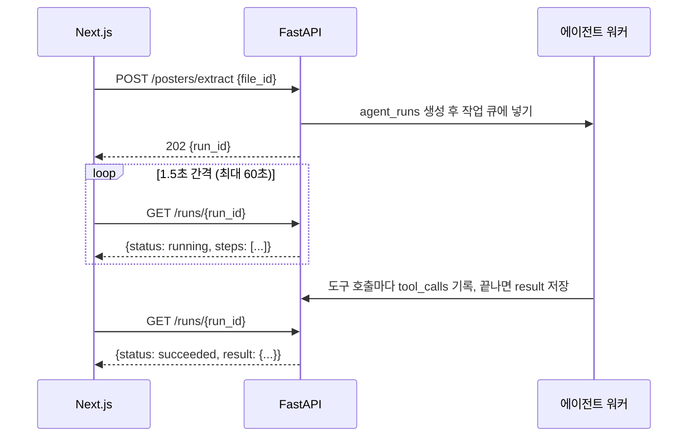

# API 명세 — 학내 정보 에이전트 MVP

> 📝 문서 상태: 초안 v0.4 · 2026-10-06 · 기준 문서: PRD v0.9, ERD v0.9
>
> v0.4 변경: 캘린더 증분 승인, 선택 동의·학과 목록·사용 이벤트 API, 판정 결과 묶음(clause)·모름 사유·기준일, 공고 공개 범위, 포스터 공유·신고·강의자료 번역 우선 하향, LMS GET 제한, 실행 단계의 도구 선택 표시, 에러 코드 추가
>
> v0.4 보강(10/9, S1-5): 피드 판정 갱신, counts 기준, cursor 규칙
>
> v0.4 보강(10/10, S1-6): 공고 상세의 판정·공개 범위·순서·처리 과정 규칙
>
> v0.4 보강(10/10, S1-6b): 공고 상세 review_reasons
>
> v0.4 보강(10/11, S1-4 후속): 강제 제출은 pipeline, 원문 확인 이유 문구
>
> v0.4 보강(10/11, 계정 화면 실제 연결): 캘린더 연결 콜백의 취소·다른 계정·Google 토큰 처리, 프론트 전용 오류 코드
>
> v0.4 보강(10/12, 공고 화면 실제 연결): 홈 피드 호출 방식, 포스터 카드 표시, profile_prompt_submitted 미결
>
> v0.4 보강(10/12, 학위과정): 프로필 degree_program, profile_completion.total 17, basis_mismatch에 석박사통합
>
> v0.4 보강(10/13, 로그인 진단): 인증 시계 차이 60초, 서버가 로그인을 확인할 수 없으면 503 AUTH_UNAVAILABLE
>
> v0.4 보강(10/13, 청년정책): 처리 과정 단계 이름 2개, 청년정책 판정 기준일, fetch-policies는 배포 때
>
> v0.4 보강(10/19, 청년정책 정기 수집): `POST /internal/jobs/fetch-policies`가 생겼다(명령과 같은 함수, 응답 모양은 12장). 서버 안 스케줄러가 매일 KST 04:00에 돌린다
>
> v0.4 보강(10/19, 캘린더 연결 해제): `DELETE /auth/google/tokens`가 생겼다(F-06). Google 쪽 권한을 거두고 저장한 토큰을 지운다. 이미 넣은 일정은 캘린더에 그대로 둔다
>
> v0.4 보강(10/19, 탈퇴): `DELETE /me`를 만들었다(F-06). 파일 → Google 권한 → profiles 순서, 파일을 못 지우면 502로 멈춤, 로그인 계정은 남김
>
> v0.4 보강(10/19, .ics 내려받기): `GET /calendar/ics`를 만들었다(F-34). 대상에 `syllabus_item_ids`를 더했고, 넣을 수 없는 대상은 건너뛰며, 기록은 남기지 않는다(PRD와 맞춤 — "provider = ics로 기록" 문장을 지웠다)
>
> v0.4 보강(10/19, 공지 첨부 저장): 동기화가 공지 첨부를 학생 문서함에 받는다(F-54). 첨부 받기 경로(`/files/{id}/download`, 토큰 없이 verifier로), 과목 상세 공지의 `attachments[]`(이름·크기·저장 상태)
>
> v0.4 보강(10/19, 문서함): `GET /files`(내 강의자료·계획서 목록)와 `GET /files/{file_id}/url`(5분짜리 받기 주소, 원래 이름으로 내려받기)을 만들었다(F-44). `GET /materials`는 강의자료 요약 목록이다(문서함은 `GET /files`)
>
> v0.4 보강(10/20, 문서함 받기): 화면이 받기 주소를 여는 대신 fetch로 받아 `file_name`으로 저장한다(저장소 CORS `*` 확인). 저장소가 파일을 주지 않으면 프론트 코드 `DOWNLOAD_FAILED`로 안내
>
> v0.4 보강(10/19, 탈퇴 저장소 가드): 파일이 있는데 서버의 저장소 설정에 고칠 점이 있으면 `DELETE /me`가 파일을 지우기 전에 `502 STORAGE_API_ERROR`로 멈춘다(publishable key로 지우면 저장소가 "없는 파일"로 답해 파일이 남는다). 지우기의 "이미 없음"은 저장소가 `NoSuchKey`로 답할 때만이다(`code` 없는 404는 실패)
>
> v0.4 보강(10/21, 탈퇴 폴더 훑기): `DELETE /me`는 기록된 파일을 지운 뒤 저장소의 내 폴더(`<user_id>/`)도 훑어 기록이 없는 파일까지 지운다(목록을 못 받으면 `502 STORAGE_API_ERROR`). 탈퇴하는 사이에 들어온 `POST /files`는 `403 CONSENT_REQUIRED`(`details.consent = terms_privacy`)다
>
> v0.4 보강(10/20, 포스터 원본 보기): 공고 상세의 `poster_url`을 `poster_kind`(`image`·`pdf`·`null`)로 바꾸고, 주소는 `GET /opportunities/{id}/poster-url`(5분, `no-store`)로 따로 받는다(W6). 내가 올린 포스터 공고만이고, 404·502 규칙은 `GET /files/{file_id}/url`과 같다
>
> v0.4 보강(10/20, 로그아웃): 설정의 로그아웃은 Supabase 세션만 끝낸다(새 API 없음). 그 전에 이 브라우저의 웹 푸시 구독을 지우고 `DELETE /push/subscriptions`를 부른다(10장 브라우저 쪽)
>
> v0.4 보강(10/20, 다른 탭 로그아웃): 한 탭에서 로그아웃·탈퇴하면 같은 브라우저에 열어 둔 다른 탭도 세션이 끝나는 순간 로그인 화면으로 간다(새 API 없음, 기록은 replace). 안내는 그 탭과 같다(`notice=signed_out`·`deleted`), 이유를 모르면 `error=session`
>
> v0.4 보강(10/25, 겹친 발송): `send-notifications`는 닫은 알림을 확정(커밋)한 뒤에 푸시한다. 둘이 겹쳐 돌아도 알림 행을 먼저 닫은 쪽만 푸시하고, `sent`·`pushable`은 이번에 닫은 알림만 센다(응답 모양은 같다)
>
> v0.4 보강(10/25, 문서함 요약): 문서함(F-44)의 강의자료 줄(직접 올린 것, 이름이 .pdf인 공지 첨부)에서도 `GET /materials/{file_id}`로 요약 칸을 연다(API 변경 없음). 과목 화면은 올리면서 요약을 고른 것이라 열자마자 `POST /materials`를 부르고, 문서함은 공지 첨부도 열 수 있어 학생이 "요약하기"를 누를 때만 부른다 — 이미 요약 중(`running`)이면 열자마자 부르지만 같은 실행에 이어 붙을 뿐 새로 보내지 않는다
>
> v0.4 보강(10/27, 탈퇴 로그인 계정): `DELETE /me`는 profiles를 지워 확정한 뒤 Supabase 로그인 계정(auth.users)도 관리자 API로 지운다(못 지워도 204, 서버 로그에 경고). 로그인 계정이 없어진 뒤 남은 토큰으로 프로필을 만들려 하면(`GET /me`·`POST /auth/google/tokens`) `401 UNAUTHORIZED`다
>
> v0.4 보강(10/13, 시·군·구 선택): 프로필 region_sigungu 값
>
> v0.4 보강(10/13, 관심 공고): PUT·DELETE /opportunities/{id}/mark, 피드 include_not_interested, my_mark, counts에서 관심 없음 공고 제외, 알림 규칙
>
> v0.4 보강(10/14, 홈 쪽 나누기): 홈은 받은 피드를 화면에서 5개씩 쪽으로 나눈다(API 변경 없음)
>
> v0.4 보강(10/14, 준비하기): 작업 큐는 TaskRunner, DEADLINE_PASSED 409, 준비하기 단계 label과 실패 이유 규칙, 할 일 제목·역산 규칙
>
> v0.4 보강(10/14, 실행 로그): 로그 연결은 한 줄 쓸 때마다 빌렸다 돌려준다(API 변경 없음)
>
> v0.4 보강(10/15, 플래너): 출처별 수정 범위(준비 할 일은 날짜만), 기간 상한 400일, include_done 기본값, 마커는 준비를 마친 공고의 마감일
>
> v0.4 보강(10/15, 포스터 등록): `POST /posters/confirm`은 기본 칸만 받고 요건·서류는 지운 것만 반영한다, 중복이면 새로 만들지 않고 200과 기존 공고
>
> v0.4 보강(10/15, 포스터 추출): Vision 한 번 호출로 `POST /posters/extract`, 초안 요건에 `clause_no`, 중복 기준(제목+마감일 같은 날), 읽기 실패 `POSTER_READ_FAILED`
>
> v0.4 보강(10/15, 포스터 업로드): `POST /files`는 지금 포스터만 받는다(HEIC 미지원), 하루 한도 20개 확정, 응답에 `reused`, 저장소 오류 `STORAGE_API_ERROR`
>
> v0.4 보강(10/15, 캘린더): 마감일 등록은 준비하기와 따로 한다(prepare에서 register_calendar 삭제), 마감 1시간 전 시작, 일정 번호를 서버가 정해 중복을 막는다
>
> v0.4 보강(10/15, 시나리오 실행): `POST /internal/eval/run`은 지금 CLI(`python -m app.eval.cli`)로 돌린다. 배포 때 같은 함수(`app/eval.run_scenarios`)를 부른다
>
> v0.4 보강(10/15, 지표 집계): `GET /internal/metrics` 응답 필드 확정(scenarios·eligibility·product), 에러 코드 `EVAL_NOT_ALLOWED` 추가
>
> v0.4 보강(10/15, 알림): 알림 예약 작업 `POST /internal/jobs/schedule-notifications` 추가, 공고 알림 세 종류의 예약 규칙과 시각(KST 09:00) 확정
>
> v0.4 보강(10/16, LMS): LMS 응답 규칙 확정(10/16 녹화), 허용 경로 여섯 개
>
> v0.4 보강(10/17, LMS 과제 동기화): LMS 과제 동기화 규칙(F-51)
>
> v0.4 보강(10/17, LMS 새 자료): 주차 항목 첫 수집 표시(F-52)
>
> v0.4 보강(10/17, 과목 상세): 과목 상세 규칙(F-14)
>
> v0.4 보강(10/17, 과제 캘린더): `POST /calendar/events`가 `lms_assignment_id`를 받는다, 동기화가 새 과제 마감을 설정 켠 사람만 자동 등록하고 마감 변경은 기존 일정만 고친다, result에 `calendar_events`·`calendar_moved`
>
> v0.4 보강(10/17, 계획서 추출): `kind = syllabus` 업로드(글자 있는 PDF 10쪽), `POST /syllabi/extract`의 과목 연결·학기 기준·근거 검사·`is_confirmed` false, 에러 `SYLLABUS_READ_FAILED`
>
> v0.4 보강(10/17, 계획서 확정): `POST /syllabi/{id}/confirm` 규칙(고른 것만 플래너·캘린더, 뺀 것은 끝내지 않은 할 일만 지움, 연결이 없으면 아무것도 바꾸지 않고 409, 시간대 없는 시각은 KST), 응답에 `calendar_events_moved`, 캘린더 대상에 `syllabus_item_id`(확인한 일정만, 시작 시각 기준 1시간)
>
> v0.4 보강(10/17, 계획서 화면): 과목 상세에 `course.syllabus_id`(확인 전 일정을 다시 열 때 쓴다), 깨진 PDF 안내는 올린 종류에 맞춘다
>
> v0.4 보강(10/17, 연 소득·취업 상태): 프로필에 `annual_income`(본인 연 소득, 만 원, 0~30000)·`job_status` 추가, `profile_completion.total` 19, 소득 선택 동의 항목 4개
>
> v0.4 보강(10/18, 과목 공지 분류): 동기화가 과목 공지를 받아 저장하고 갈래를 나눈다(F-53 1부). `new_announcements`는 처음 본 공지 수, 기회성 공지는 그 과목 수강생만 보는 공고가 된다. `GET /lms/updates`의 `announcement` 항목을 채운다
>
> v0.4 보강(10/18, 일정 변경 공지): 일정 변경 공지는 바뀌는 날에 플래너 할 일(`source = lms_announcement`, 완료만 수정)과 `schedule_change` 알림을 **그 과목 수강생 모두에게** 만든다(F-53 2부). 새 글 피드의 `planner_task_id`가 그 할 일이다
>
> v0.4 보강(10/18, 계획서 일정 캘린더 표시): 계획서 일정에 `calendar_registered`가 생겼다(과제 목록과 같은 기준). 화면이 "캘린더에 넣기" 버튼을 숨기는 값이다
>
> v0.4 보강(10/18, 웹 푸시): `POST`·`DELETE /push/subscriptions`와 **실제 푸시 발송**(F-33). 발송 작업 응답에 `pushed`·`push_failed`·`push_dropped`가 붙고, 푸시 페이로드의 `url` 규칙을 적었다. VAPID 키가 없으면 푸시를 보내지 않고 알림함에만 쌓는다
>
> v0.4 보강(10/18, 웹 푸시 2부): 브라우저 쪽 규칙(서비스 워커 `/sw.js`, 권한을 묻는 때, 기기마다 하는 구독, 앱을 열 때 되올림)을 10장에 적었다. 공개 키(`NEXT_PUBLIC_VAPID_PUBLIC_KEY`)가 없으면 web은 켜는 자리를 숨긴다
>
> v0.4 보강(10/21, F-23·F-24): 피드 아이템의 `recommend_reason`을 채운다(맞는 조건 이름 한 줄). `GET /opportunities/{id}/alternatives`의 "비슷한 난이도"를 필수 서류 수로 정하고 기준 공고·후보·오류를 적었다
>
> v0.4 보강(10/30, 상세 1차): 공고 상세에 `apply_url`(청년정책 원문의 '신청 사이트' 칸이 http·https 주소 하나일 때만, 그 밖은 null). 사용자 피드백 — 온통청년을 한 번 더 거치지 않고 신청 사이트로 바로 간다
>
> v0.3 변경: 디자인 초안 대조 반영 — 엔드포인트 6개 추가(동의 기록, 설정, 알림함 목록·읽음, 과목 상세), 피드·상세에 `display_status`·`easy_summary`·`is_new`·조건 문구·`eligibility.summary`, 서류와 플래너 할 일 연결, 포스터 2쪽 PDF, 플래너 마감 `markers`, 상시 공고 `target_date`, LMS 과목 새 자료 수·`course.html_url`, 알림 `link.course_id`, 에러 코드 4개(`CONSENT_REQUIRED`·`PAGE_LIMIT_EXCEEDED`·`DB_UNAVAILABLE`·`INTERNAL_ERROR`)
>
> v0.2 변경: 강의자료 API를 구간 요약 + 선택 구간 번역 구조로 변경, 분량 상한을 토큰 기준으로 변경
>
> 이 문서는 **프론트(Next.js)와 백엔드(FastAPI) 사이의 계약**이다. W1에 확정하면 프론트는 이 형식의 목데이터로 화면을 먼저 만들고, 백엔드는 같은 형식으로 실제 응답을 맞춘다. FastAPI가 자동 생성하는 OpenAPI(`/docs`)가 최종 기준이 되도록 Pydantic 모델을 이 문서대로 작성하고, 프론트 타입은 `openapi-typescript`로 생성한다.

---

## 목차

1. 공통 규칙
2. 비동기 작업(에이전트 실행) 패턴
3. 엔드포인트 한눈에 보기
4. 인증 · 내 정보
5. 공고 피드 · 상세 · 신고
6. 업로드 · 포스터
7. 준비하기 · 플래너 · 캘린더
8. 강의계획서 · 강의자료
9. LMS 연동
10. 알림
11. 에이전트 실행 조회
12. 내부 · 운영 API
13. 에러 코드
14. 결정이 필요한 것

부록: 프론트 반영 목록

---

## 1. 공통 규칙

| 항목 | 규칙 |
| --- | --- |
| Base URL | `https://{api-host}/api/v1` |
| 인증 | `Authorization: Bearer {Supabase access token}`. FastAPI가 Supabase JWT를 검증해 `user_id`를 얻는다. 4장의 로그인 콜백을 제외한 모든 사용자 API에 필요. 서버와의 시계 차이는 60초까지 허용한다. 토큰이 없거나 만료·위조·다른 프로젝트의 토큰이면 401 `UNAUTHORIZED`, 서버가 토큰을 확인할 수 없으면(공개키를 받지 못함, `SUPABASE_URL`이 비었거나 틀림) 503 `AUTH_UNAVAILABLE`이다 |
| 데이터 접근 | 프론트는 DB를 직접 읽지 않는다(기존). DB의 모든 테이블에 RLS가 켜져 있고 클라이언트 쓰기 정책은 없다. 백엔드는 테이블 소유자로 연결해 RLS를 받지 않으므로, 공고 조회 쿼리에 5장의 공개 범위를 직접 건다 |
| 형식 | JSON, 필드명 `snake_case`, UTF-8 |
| 시간 | 일시는 ISO 8601 + 오프셋 (`2026-10-15T23:59:00+09:00`), 날짜만은 `YYYY-MM-DD`. DB는 UTC 저장. 날짜로 바꿀 때(due_date, D-day, 판정 기준일)는 항상 Asia/Seoul 기준이다. 날짜에 따라 결과가 바뀌는 코드는 현재 시각을 인자로 받는다(테스트에서 고정) |
| ID | UUID 문자열. Canvas ID는 숫자 그대로 |
| 목록 | 커서 페이지네이션: `?limit=20&cursor={next_cursor}` → 응답 `{ "items": [...], "next_cursor": "..." \| null }` |
| 업로드 | `multipart/form-data`, 파일 1개, 최대 20MB. 강의자료 분량 상한은 업로드가 아니라 요약 요청 때 토큰 기준으로 판정(8장) |
| 에러 | `{ "error": { "code": "LMS_TOKEN_INVALID", "message": "사람이 읽는 메시지", "details": {} } }` (13장) |
| 상태 코드 | 200 조회·수정, 201 생성, 202 비동기 작업 접수, 204 삭제, 400 잘못된 요청, 401 인증 없음, 403 권한 없음, 404 없음, 409 충돌·중복, 413 파일 초과, 422 검증 실패, 429 한도 초과, 502 외부 서비스 오류, 503 잠시 처리할 수 없음(DB 연결·로그인 확인) |
| 비밀값 | LMS 토큰·Google 토큰은 **요청 본문으로 받기만 하고 어떤 응답에도 내보내지 않는다.** 로그와 에러 추적에서 Authorization 헤더와 토큰 모양 문자열을 가린다. 프로필 값은 LLM 호출과 `tool_calls.input`에 넣지 않는다 |
| 파일 URL | Storage 파일은 API가 만든 서명 URL로만 준다. 수명은 5분이다(v0.3 `poster_url`의 1시간을 줄임) |
| 외부 호출 | LearningX 클라이언트는 GET 요청과 9장의 허용 경로만 호출한다 |

## 2. 비동기 작업(에이전트 실행) 패턴

LLM을 부르는 작업(포스터 추출, 준비하기, 계획서 추출, 강의자료 요약, LMS 동기화)은 수 초–수십 초가 걸린다. 그래서 요청은 바로 `202`와 `run_id`를 돌려주고, 프론트는 실행 상태를 조회한다. 이 실행 기록이 곧 "처리 과정 표시"(F-42)와 성공률·응답시간·비용 측정의 원천이다.



- 접수 응답: `202 { "run_id": "uuid", "status": "running" }`
- 폴링 간격 1.5초, 60초가 지나도 끝나지 않으면 "백그라운드에서 계속 처리 중" 안내 후 폴링 중단(완료되면 웹 푸시)
- 같은 작업을 중복 요청하면 진행 중인 `run_id`를 그대로 돌려준다(예: 같은 공고 준비하기 연타)
- MVP 작업 큐는 요청과 따로 도는 asyncio 작업(`app/background.py`의 `TaskRunner`)이고, 부하가 생기면 별도 워커로 분리. FastAPI `BackgroundTasks`는 요청의 의존성(DB 연결·트랜잭션)이 정리되기 전에 돌아 잠금을 붙잡아서 쓰지 않는다. 서버를 끌 때 돌던 작업을 10초까지 기다리고, 못 끝낸 작업은 다음 요청이 멈춘 실행으로 보고 정리한다. 실행 로그(agent_runs·tool_calls·llm_calls)는 한 줄 쓸 때마다 로그 풀에서 연결을 빌렸다 돌려준다. 실행이 끝날 때까지 쥐고 있으면 모델을 기다리는 동안 풀이 막혀, 동시에 돌 수 있는 작업 수가 풀 크기로 묶인다

## 3. 엔드포인트 한눈에 보기

| 분류 | 메서드 · 경로 | 설명 | 기능 | 우선 |
| --- | --- | --- | --- | --- |
| 인증 | `POST /auth/google/tokens` · `DELETE /auth/google/tokens` | 캘린더를 연결할 때 Google 토큰 저장 (로그인 때는 부르지 않음) · 연결 해제 | F-01, F-32, F-06 | P0 |
| 인증 | `GET /auth/hyin/start` · `GET /auth/hyin/callback` | HY-in 인증 | F-05 | P2 |
| 내 정보 | `GET /me` | 내 계정·연동 상태 요약 | F-01 | P0 |
| 내 정보 | `GET /me/profile` · `PATCH /me/profile` | 판정용 프로필 조회·수정(수정 시 재판정) | F-02–F-04 | P0 |
| 내 정보 | `POST /me/consents` | 약관·개인정보 동의 기록 | F-02 | P0 |
| 내 정보 | `GET /me/settings` · `PATCH /me/settings` | 알림·LMS 과제 자동 등록 설정 | F-06 | P1 |
| 내 정보 | `PATCH /me/consents` | 소득·수급 선택 동의와 철회 | F-02, F-06 | P0 |
| 메타 | `GET /meta/departments` | 학과 목록 | F-02 | P0 |
| 사용 기록 | `POST /events` | 화면에서만 알 수 있는 사용 이벤트 기록 | 8장 지표 | P0 |
| 내 정보 | `DELETE /me` | 탈퇴(모든 개인 데이터·토큰 삭제) | 7장 | P0 |
| 공고 | `GET /opportunities` | 추천 피드 | F-40 | P0 |
| 공고 | `GET /opportunities/{id}` | 공고 상세(조건별 판정표·서류·준비 상태) | F-41 | P0 |
| 공고 | `GET /opportunities/{id}/poster-url` | 내가 올린 포스터의 원본을 5분 동안 보는 주소 | F-41 | P0 |
| 공고 | `PUT /opportunities/{id}/mark` · `DELETE /opportunities/{id}/mark` | 관심·관심 없음(숨기기) 표시와 지우기 | F-45 | P1 |
| 공고 | `GET /opportunities/{id}/alternatives` | 대체 공고 | F-23 | P1 |
| 공고 | `POST /opportunities/{id}/reports` | 신고 | F-17 | P1 |
| 업로드 | `POST /files` | 파일 업로드 → `file_id` | F-13–F-15 | P0 |
| 문서함 | `GET /files` · `GET /files/{file_id}/url` | 내 강의자료·계획서 목록, 5분짜리 받기 주소 | F-44 | P1 |
| 포스터 | `POST /posters/extract` | 포스터 추출(비동기) | F-13 | P0 |
| 포스터 | `POST /posters/confirm` | 확인·수정 후 공고 등록(중복이면 병합) | F-13, F-16 | P0 |
| 준비 | `POST /opportunities/{id}/prepare` | 준비하기(서류·역산 일정·캘린더, 비동기) | F-30–F-32 | P0 |
| 플래너 | `GET /planner/tasks` · `POST /planner/tasks` | 플래너 조회·직접 추가 | F-43 | P0 |
| 플래너 | `PATCH /planner/tasks/{id}` · `DELETE /planner/tasks/{id}` | 완료 체크·수정·삭제 | F-31, F-43 | P0 |
| 캘린더 | `POST /calendar/events` · `DELETE /calendar/events/{id}` | 캘린더 등록·해제 | F-32 | P0 |
| 캘린더 | `GET /calendar/ics` | .ics 내려받기 | F-34 | P1 |
| 계획서 | `POST /syllabi/extract` · `POST /syllabi/{id}/confirm` | 계획서 일정 추출·확정 | F-14 | P0 |
| 강의자료 | `POST /materials` · `GET /materials/{file_id}` · `GET /materials` | 축소판 요약 | F-15 | P1 |
| 강의자료 | `POST /materials/{file_id}/translations` | 구간 번역 | — | 삭제 (확장 범위) |
| LMS | `POST /lms/connection` · `GET /lms/connection` · `DELETE /lms/connection` | 토큰 연결·상태·해제 | F-50 | P0 |
| LMS | `POST /lms/sync` | 즉시 동기화(대시보드 접속 시) | F-51 | P0 |
| LMS | `GET /lms/courses` | 수강 과목 + 계획서 바로가기 | F-14, F-51 | P0 |
| LMS | `GET /lms/courses/{id}` | 과목 상세: 과제·주차 자료·공지·계획서·내 자료, 열람 기록 | F-14, F-15, F-51–F-53 | P0 |
| LMS | `GET /lms/assignments` | 과제·제출 상태 | F-51 | P0 |
| LMS | `GET /lms/updates` | 새 주차학습 항목·과목 공지 피드 | F-52, F-53 | P0 |
| 알림 | `POST /push/subscriptions` · `DELETE /push/subscriptions` | 웹 푸시 구독·해제 | F-33 | P0 |
| 알림 | `GET /notifications` | 알림함 목록과 안 읽은 수 | F-35 | P0 |
| 알림 | `POST /notifications/read` | 읽음 처리(선택 또는 전체) | F-35 | P0 |
| 실행 | `GET /runs/{id}` | 에이전트 실행 상태·처리 과정·결과 | F-42 | P0 |
| 내부 | `POST /internal/jobs/{job}` | 스케줄러 배치(크롤링·LMS 동기화·알림) | 6장 | P0 |
| 내부 | `POST /internal/eval/run` | 테스트 시나리오 실행 | 8장 | P0 |
| 운영 | `POST /internal/jobs/crawl-contests` · `POST /admin/opportunities/{id}/restore` | 공모전 수집, 숨김 복구 | F-12, F-17 | P1 |

## 4. 인증 · 내 정보

### `POST /auth/google/tokens`

로그인과 캘린더 연결을 나눈다(증분 승인). 요청·응답 형식은 v0.2 그대로다.

1. **로그인**: supabase-js Google 로그인으로 기본 범위(이메일·프로필)만 받는다. 이 API는 부르지 않는다. `GET /me`의 `calendar_connected`는 false다.
2. **연결**: 캘린더가 필요한 순간에 Google 로그인을 한 번 더 부른다. 그 순간은 준비하기 결과 화면에서 "캘린더에도 등록"을 고를 때, 설정에서 캘린더를 연결할 때, LMS 과제 자동 등록을 켤 때다. 요청 값은 다음과 같다.
   - scope: `https://www.googleapis.com/auth/calendar.events`
   - `access_type=offline`, `prompt=consent`, `include_granted_scopes=true`
   - 돌아올 화면은 redirectTo의 `next`로 넘긴다

   콜백에서 받은 provider 토큰을 이 API로 보낸다.
   - 연결을 시작할 때 login_hint로 지금 로그인한 계정을 넘긴다
   - Google 화면에서 취소하면 code 없이 돌아온다. 콜백은 로그인을 그대로 두고 next?calendar=error로 보낸다. 코드 교환이 실패해도 같다
   - 코드 교환 전 사용자와 교환 뒤 사용자가 다르면(다른 Google 계정을 고름) 토큰을 저장하지 않고, 바뀐 세션을 그 기기에서 지운 뒤 /login?error=other_account로 보낸다
   - Google 토큰(provider_token·provider_refresh_token)은 코드 교환 직후 세션에만 실려 온다. 콜백은 이 API를 부른 뒤 세션을 한 번 새로 받아 브라우저 쿠키에 Google 토큰을 남기지 않는다. 새로 받지 못하면 그 기기에서 로그아웃한다. 로그인 콜백도 같다
3. **끊김**: refresh가 실패하면(만료·취소) 서버는 저장한 토큰을 지운다. 그 뒤 캘린더가 필요한 API는 `409 CALENDAR_NOT_CONNECTED`(`details.reason`: `not_connected` · `expired`)를 돌려주고, 프론트는 2번 연결 흐름으로 보낸다.

S1-1 완료 조건을 다음으로 바꾼다. 로그인만으로는 캘린더 권한을 묻지 않는다. 연결 후 이벤트를 만들 수 있다. access token이 만료된 뒤 refresh로 다시 만들 수 있다.

```json
// Request
{ "provider_token": "ya29...", "provider_refresh_token": "1//0g..." }

// Response 200
{ "calendar_connected": true, "scope": "calendar.events" }
```

에러: `GOOGLE_REFRESH_TOKEN_MISSING`(422, 재로그인 필요)

### `DELETE /auth/google/tokens`

`204`. 캘린더 연결을 해제한다(F-06). 설정의 "연결 해제"가 부른다.

- **Google 쪽 권한도 거둔다**(`https://oauth2.googleapis.com/revoke`에 refresh token을 보낸다 — 그 승인 전체가 풀린다). 거두지 못해도(Google이 막힘) 저장한 토큰은 지운다. 못 거둔 권한은 학생이 Google 계정 설정에서 직접 거둘 수 있다. 이미 풀린 토큰(Google이 400)은 성공으로 본다
- 저장한 토큰(`oauth_tokens`)을 지운다. 그 뒤 `GET /me`의 `calendar_connected`는 false이고, 캘린더가 필요한 API는 `409 CALENDAR_NOT_CONNECTED`(`not_connected`)다
- **이미 넣은 일정은 학생의 캘린더에 그대로 둔다**(설정의 LMS 자동 등록을 끌 때와 같다). `calendar_events` 기록도 남겨서 다시 연결하면 그 일정을 그대로 다룬다
- 연결이 없어도 `204`다(두 번 눌러도 같다). 설정의 `calendar_auto_lms`는 바꾸지 않는다 — 연결이 없는 동안 동기화는 캘린더만 건너뛴다

### `GET /auth/hyin/start` · `GET /auth/hyin/callback` (P1)

`start`는 HY-in OAuth 인증 페이지로 302 리다이렉트한다. `callback`은 받은 정보 중 **재학 여부·소속 학과·입학년도만** 프로필에 반영하고 학번·성명은 버린 뒤 프론트 설정 화면으로 리다이렉트한다.

### `GET /me`

```json
{
  "user_id": "uuid",
  "display_name": "김현준",
  "hyin_verified": false,
  "calendar_connected": false,
  "lms": { "status": "active", "last_synced_at": "2026-10-01T10:30:00+09:00" },
  "profile_completion": { "filled": 6, "total": 19 },
  "consented": true,
  "income_info_consented": false,
  "unread_notifications": 3
}
```

- `consented`: 약관·개인정보 동의를 마쳤는지. false면 프론트가 온보딩 동의 단계로 보낸다
- `unread_notifications`: 헤더 알림 배지 숫자
- `income_info_consented`: 소득·수급 정보 선택 동의를 했는지. false면 소득 입력란을 열지 않는다
- `profile_completion.total`은 19다. 유학생 여부로 16, 학위과정으로 17, 취업 상태·본인 연 소득으로 19가 됐다(F-21). 평점 만점은 세지 않는다
- `calendar_connected`는 로그인만 한 상태에서는 false다(증분 승인)
- `hyin_verified`는 F-05가 P2라 MVP에서는 늘 false다

### `POST /me/consents` · `PATCH /me/consents`

```json
// POST /me/consents (온보딩 동의 단계) Request
{ "consent_version": "2026-10-06", "agree_terms": true, "agree_privacy": true, "agree_income_info": false }

// Response 200
{ "terms_agreed_at": "2026-10-06T14:00:00+09:00", "privacy_agreed_at": "2026-10-06T14:00:00+09:00",
  "income_info_agreed_at": null, "consent_version": "2026-10-06" }

// PATCH /me/consents (온보딩 소득 단계, 설정) Request
{ "agree_income_info": true }

// Response 200
{ "income_info_agreed_at": "2026-10-06T14:05:00+09:00" }
```

- `agree_income_info`는 선택 동의다. 빼면 false로 본다
- PATCH로 false를 보내면 동의 시각과 소득 4항목(`income_bracket`, `median_income_pct`, `annual_income`, `welfare_status`)을 한 번에 지우고, 그 사용자의 판정을 다시 계산한다
- 필수 동의 전에는 PATCH도 `403 CONSENT_REQUIRED`를 돌려준다
- 둘 중 하나라도 false면 `422 VALIDATION_FAILED`
- 동의 전에는 `/me/profile` 수정과 공고·플래너 API가 `403 CONSENT_REQUIRED`를 돌려준다
- POST /me/consents에서 갖고 있던 소득 동의를 빼도 소득 3항목을 지우고 판정을 다시 계산한다.

### `GET /me/profile` · `PATCH /me/profile`

모든 필드 nullable. `PATCH`는 보낸 필드만 바꾸고 `null`을 보내면 지운다. 수정되면 해당 사용자의 판정을 다시 계산한다(코드 비교라 동기 처리).

```json
// PATCH Request (F-03 즉석 입력도 같은 API 사용)
{ "gpa_last_semester": 3.62, "semesters_completed": 5 }

// Response 200
{
  "profile": {
    "department": "인공지능학과", "degree_program": "bachelor", "grade": 3, "enrollment_status": "enrolled",
    "semesters_completed": 5,
    "credits_total": 98.0, "credits_last_semester": 18.0,
    "gpa_total": 3.71, "gpa_last_semester": 3.62, "gpa_scale": 4.5,
    "birth_date": null, "military_service_months": null,
    "region_sido": "경기도", "region_sigungu": "안산시 단원구",
    "income_bracket": null, "median_income_pct": null, "annual_income": null, "welfare_status": null,
    "job_status": "unemployed",
    "is_international": false,
    "admission_year": null, "hyin_verified_at": null
  },
  "rejudged": { "changed": 3, "eligible": 12, "undetermined": 7, "ineligible": 9 }
}
```

- `department`에는 `GET /meta/departments`의 이름만 쓸 수 있다. 없는 이름은 `422 VALIDATION_FAILED`(`details.fields.department`)
- `is_international`을 추가한다(boolean, null이면 미입력)
- `degree_program`(학위과정)을 추가한다. `bachelor` 학부, `master` 석사, `doctoral` 박사, `integrated` 석박사통합이고 null이면 미입력이다. 지금 다니는 과정이고, 졸업했으면 마지막으로 다닌 과정이다. 다른 값은 `422 VALIDATION_FAILED`(`details.fields.degree_program`)
- 소득 4항목(`income_bracket`·`median_income_pct`·`annual_income`·`welfare_status`)은 선택 동의 전이면 `403 CONSENT_REQUIRED`(`details.consent = "income_info"`)
- `annual_income`은 **본인** 연 소득이고 단위는 만 원이다(가구 합산·기준 중위소득은 `median_income_pct`가 맡는다). 0~30000(3억)이고 넘으면 `422 VALIDATION_FAILED`다 — DB 칸이 smallint라 그 안에 둔다
- `job_status`(취업 상태)는 `unemployed`·`employed`·`self_employed`·`freelancer`·`short_term`·`daily_worker`·`founder`·`farmer`다. 소득 항목이 아니라 선택 동의 없이 저장한다. 다른 값은 `422 VALIDATION_FAILED`(`details.fields.job_status`)
- 거주지역(`region_sido`, `region_sigungu`)은 주민등록 주소 기준이다. 입력 화면에 그렇게 적는다
- `region_sigungu`는 시·도 안의 시·군·구 이름이고 구가 있는 시는 구까지 쓴다(예: `안산시 단원구`). 웹은 시·도를 고르면 그 안의 목록(법정동코드 2026-09-29 판의 끝 지역)에서 고르게 한다. 서버는 목록으로 검사하지 않고 그대로 저장하며, 판정할 때 앞에 붙은 시·도 이름을 뗀다(`docs/판정엔진_규칙.md` 4-2)
- 보낸 항목 중 값이 실제로 바뀐 것만 저장하고, 바뀐 값이 있으면 그 사용자의 활성 공고를 모두 다시 판정한다. rejudged.changed는 판정이 있던 공고 중 라벨(display_status)이 바뀐 수이고, eligible·undetermined·ineligible은 GET /opportunities의 counts와 같은 기준이다.

에러: `VALIDATION_FAILED`(422, 예: `gpa_last_semester > gpa_scale`)

### `GET /me/settings` · `PATCH /me/settings` (P1)

```json
{ "push_enabled": true, "muted_notification_types": ["new_material"], "calendar_auto_lms": true }
```

- `PATCH`는 보낸 필드만 바꾸고, 행이 없으면 기본값으로 만든다. 아무 필드도 보내지 않거나 모르는 필드·모르는 알림 종류를 보내면 `422 VALIDATION_FAILED`다
- 설정을 바꾼 적이 없으면 `GET`은 DB 기본값을 준다(푸시 켬 · 끈 종류 없음 · LMS 과제 자동 캘린더 등록 켬)
- `calendar_auto_lms`를 끄면 이후 새 과제만 캘린더에 넣지 않는다. 이미 등록한 일정은 지우지 않는다

### `GET /meta/departments`

```json
{ "items": [ { "name": "기계공학과", "college": "공학대학", "field_group": "공학계열" } ] }
```

- 위 값은 형식 예시다. 실제 목록은 seed 마이그레이션으로 넣는다
- `is_active`인 학과만 `sort_order`, 이름 순으로 준다. 로그인이 필요하다
- 목록은 학과 목록 seed 마이그레이션으로 넣고, 단과대학 순(sort_order)으로 준다. 폐지한 학과(is_active false)는 주지 않는다.

### `POST /events`

```json
// Request
{ "event": "profile_prompt_shown", "opportunity_id": "uuid" }

// Response 204
```

- 프론트가 보내는 이벤트는 3가지다: `app_open`(앱을 열 때, KST 하루 1건만 저장), `profile_prompt_shown`(정보 입력창을 띄울 때), `lms_guide_opened`(LMS 연결 가이드를 열 때)
- `profile_prompt_submitted`, `lms_connected`는 서버가 해당 API 안에서 직접 기록한다. 프론트가 보내면 `422 VALIDATION_FAILED`
- 화면은 응답을 기다리지 않는다. 기록에 실패해도 화면은 그대로 둔다

### `DELETE /me`

`204`. Google·LMS 토큰, 프로필, 업로드 파일, 판정·플래너·캘린더 기록과 Supabase 로그인 계정을 삭제한다. 사용자가 올린 공유 포스터 공고는 남기되 업로더를 비운다(ERD `on delete set null`). Google 캘린더에 이미 등록된 일정은 지우지 않는다.
- 순서는 **파일 → Google 권한 → DB → 로그인 계정**이다. 저장소의 파일(`files.storage_path` 전부)을 먼저 지우고, 하나라도 지우지 못하면 `502 STORAGE_API_ERROR`로 멈추며 아무것도 바꾸지 않는다(다시 누르면 처음부터 다시 한다. 이미 지운 파일은 없는 것으로 지나간다)
- 그다음 저장소의 내 폴더(`<user_id>/`)를 훑어 기록이 없는 파일(올린 뒤 기록이 남지 못한 것)도 지운다. 목록을 받지 못하면 같은 `502 STORAGE_API_ERROR`로 멈춘다. 서버의 저장소 설정이 없거나 틀리면 훑지 않는다 — 그때 기록된 파일이 없으면 저장소를 부르지 않는다
- 프로필을 지우기 직전에 `profiles` 행을 잠그고 파일 목록을 다시 받아, 그사이 들어온 파일도 지운다. 잠근 뒤 들어오는 `POST /files`는 `403 CONSENT_REQUIRED`가 되고 올린 파일은 지워진다
- 지우기에서 "이미 없음"으로 지나가는 것은 저장소가 본문 `code: NoSuchKey`로 답한 때뿐이다(지금 Supabase는 HTTP 400). `code` 없는 404·410은 주소가 틀려 저장소가 아닌 곳이 답한 것일 수 있어 지우기 실패로 보고 `502 STORAGE_API_ERROR`로 멈춘다
- 단 파일이 있는데 서버의 저장소 설정에 고칠 점이 있으면(publishable key 등 — 그런 키로 지우면 저장소가 파일을 못 보고 없는 파일처럼 `NoSuchKey`로 답해, 파일을 남긴 채 지운 것으로 넘어간다) 저장소를 부르지 않고 같은 `502 STORAGE_API_ERROR`로 멈춘다. 문구도 같고, 무엇을 고칠지는 서버 로그에만 남긴다. 파일이 없으면 설정을 보지 않는다
- Google 캘린더 권한은 `DELETE /auth/google/tokens`와 같은 함수로 거둔다(거두지 못해도 계속한다)
- `profiles` 행을 지우면 딸린 행은 cascade로 사라지고, 공유 포스터 공고의 업로더와 실행 로그(`agent_runs`)의 사용자는 null이 된다(ERD 1장). 실행 로그는 지표 집계를 위해 남는다(딸린 `tool_calls`·`llm_calls`도 남는다)
- 그 삭제를 확정(커밋)한 뒤 **Supabase 로그인 계정**(auth.users)을 관리자 API(`DELETE {SUPABASE_URL}/auth/v1/admin/users/{id}`, 키는 `SUPABASE_SECRET_KEY`)로 지운다. 확정 전에 부르면 Supabase의 auth.users → profiles cascade가 이 요청의 잠금을 기다린다. 이미 없는 계정(404 `user_not_found`)은 지운 것으로 본다. 지우지 못해도(닿지 못함, 키가 틀림, 설정 없음) Google 권한처럼 계속해 `204`이고 이유는 서버 로그에 경고로 남는다 — 개인 데이터는 이미 지워 확정했다. 남은 계정으로 다시 누르면 다시 지운다
- 프론트는 204를 받으면 이 기기의 세션을 지우고 로그인 화면으로 보낸다(supabase-js는 로그아웃할 때 사용자가 없다는 답을 무시하고 세션을 지운다). 같은 브라우저에 열어 둔 다른 탭도 "탈퇴했어요" 안내와 함께 로그인 화면으로 간다(세션을 지우기 직전에 탭끼리 이유를 알린다). 다른 기기에 남은 토큰은 만료(최대 1시간)까지 살아 있지만, 프로필이 없어 다시 만들려 하면 `401 UNAUTHORIZED`라 로그인 화면으로 간다. 다시 로그인하면 새 계정으로 동의부터 시작한다
- 프로필이 이미 없어도 `204`다(두 번 눌러도 같다)

## 5. 공고 피드 · 상세 · 신고

### 공개 범위

피드·상세·플래너는 모두 같은 규칙을 쓴다(ERD 5장, RLS와 같음).

- 활성 공고: 포스터는 올린 본인만, 과목 공지 공고는 그 과목 수강생만, 나머지는 로그인 사용자 모두 볼 수 있다
- 준비를 시작한 공고는 마감(`expired`)·숨김(`hidden`)이 되어도 본인에게 상세·서류·플래너가 계속 보인다. 피드에는 나오지 않는다
- 그 밖의 숨김·과목 비공개 공고는 `404 NOT_FOUND`다(v0.2 그대로)
- 준비를 시작한 공고는 병합(merged)되거나 수강을 끝낸 과목의 공지여도 본인에게 보인다. 공개 범위 안의 마감 공고(마감일이 지났거나 expired)는 준비하지 않아도 상세가 열린다(피드 include_expired로 카드가 보인다).

### `GET /opportunities`

| 파라미터 | 값 | 기본 |
| --- | --- | --- |
| `eligibility` | `eligible` \| `undetermined` \| `ineligible` \| `all`, 쉼표로 여러 개 | `all` |
| `category` | ERD `opportunity_category` 값, 쉼표로 여러 개 | 전체 |
| `source_type` | ERD `source_type` 값, 쉼표로 여러 개 | 전체 |
| `sort` | `deadline` \| `recent` | `deadline` |
| `include_expired` | `true` \| `false` | `false` |
| `include_not_interested` | `true` \| `false`. 관심 없음으로 표시한 공고도 준다(F-45) | `false` |
| `limit`, `cursor` | 1–50 | 20 |

서버는 `status = active`이고, `visible_canvas_course_id`가 없거나 사용자가 그 과목 수강생인 공고만 내려준다.

- `eligibility`는 쉼표로 여러 값을 받는다. 홈은 eligibility 없이 50개씩 next_cursor가 없을 때까지(최대 1,000개) 받아 화면에서 지원 어려움을 맨 아래 묶음으로 나눈다. 묶음 개수가 칩(category)과 맞아야 해서 따로 부르지 않는다. 목록과 지원 어려움 묶음은 화면에서 5개씩 쪽으로 나눈다(F-40). 쪽을 넘길 때 API를 다시 부르지 않는다
- `sort=deadline`은 마감일 없는 공고를 맨 뒤로 보낸다
- `counts`는 카테고리 필터와 상관없이 전체 기준이다(ERD 집계 쿼리)
- 관심 없음(F-45)으로 표시한 공고는 `include_not_interested=true`일 때만 목록에 나오고, counts에는 늘 넣지 않는다. 홈은 `include_not_interested=true`로 받아 추천 공고·관심·숨김 탭을 화면에서 나눈다

```json
{
  "items": [
    {
      "id": "uuid",
      "title": "2026-2 한양브레인 장학금",
      "organizer": "ERICA 학생지원팀",
      "category": "scholarship",
      "source_type": "school_notice",
      "deadline_at": "2026-10-15T23:59:00+09:00",
      "d_day": 14,
      "easy_summary": "직전학기 성적이 좋은 학생에게 등록금 일부를 감면해 줘요.",
      "is_new": true,
      "eligibility": {
        "status": "undetermined",
        "display_status": "missing_info",
        "summary": "직전학기 이수학점을 입력하면 판정할 수 있어요",
        "missing_fields": ["credits_last_semester"]
      },
      "recommend_reason": "학과·직전학기 평점 조건이 맞아요",
      "needs_review": false,
      "uploaded_by_me": false,
      "course_name": null,
      "prepared": false,
      "my_mark": "interested"
    },
    {
      "id": "uuid",
      "title": "데이터베이스 연구실 연구 참여 학생 모집",
      "category": "research",
      "source_type": "lms_announcement",
      "deadline_at": null,
      "easy_summary": "데이터베이스 연구실에서 학부 연구 참여 학생을 모집해요.",
      "is_new": false,
      "eligibility": { "status": "eligible", "display_status": "eligible", "summary": "제시된 조건 없음", "missing_fields": [] },
      "needs_review": true,
      "uploaded_by_me": false,
      "course_name": "데이터베이스",
      "prepared": false
    }
  ],
  "next_cursor": "eyJkIjoiMjAyNi0xMC0xNSJ9",
  "counts": {
    "eligible": 8, "new_eligible": 2,
    "undetermined": 3, "missing_info": 2, "needs_review": 1,
    "ineligible": 9,
    "deadline_soon": 2
  }
}
```

- `uploaded_by_me`: 내가 올린 포스터인지. 포스터 카드는 주최 옆에 "내가 올린 포스터"를 붙이고, 상세는 부제에 쓴다. 업로더 이름은 표시하지 않는다
- `recommend_reason`(F-24): 내 정보로 맞는다고 판정한 조건의 이름(원문 순서, 셋까지, 넘으면 "외 N개"). 지원 가능은 "… 조건이 맞아요", 정보 필요·원문 확인은 "… 조건은 맞아요", 지원 어려움·이름을 쓸 조건이 없으면 `null`이다. 학과 조건은 비교 단위(학과·단과대학·계열)로 쓰고, 소득·수급·유학생 여부·학위과정·기타 조건은 쓰지 않는다. 저장하지 않고 읽을 때 만든다
- `eligibility.display_status`: `eligible` \| `missing_info` \| `needs_review` \| `ineligible`. 화면 라벨(지원 가능·정보 필요·원문 확인 필요·지원 어려움)에 1:1로 대응한다
- `easy_summary`는 카드 설명 한 줄, `is_new`는 등록 7일 이내이고 아직 상세를 열지 않은 지원 가능 공고다
- `my_mark`(F-45): 내 표시. `interested`(관심) \| `not_interested`(관심 없음, 화면 이름 "숨기기") \| null(표시 없음)
- 응답 전에 그 사용자의 낡은 판정을 다시 계산한다(기준은 ERD 5장).
- 요건 추출에 실패한 공고의 eligibility는 status undetermined, display_status needs_review, summary "원문 확인 필요: 자격 요건을 정리하지 못함", missing_fields []다. 판정 엔진이 오류를 낸 공고는 summary가 "원문 확인 필요: 조건을 판정하지 못함"이다.
- counts는 eligibility·category·source_type·include_expired·include_not_interested와 상관없이 지금 보이는 활성 공고(마감 전) 전체 기준이고, 관심 없음 공고는 세지 않는다.
- sort=recent는 등록 최신순이다. 두 정렬 모두 값이 없는 공고가 맨 뒤이고, 값이 같으면 id 순이다.
- include_expired=true면 마감이 지났거나 expired인 공고도 준다.
- cursor는 같은 정렬·필터로 다음 페이지를 부를 때만 쓴다. 정렬·필터를 바꾸면 처음부터 다시 부른다. 다르거나 망가진 cursor는 422 VALIDATION_FAILED(details.fields.cursor)다.
- include_not_interested도 cursor 범위에 들어간다. 값을 바꾸면 처음부터 다시 부른다.
- 알 수 없는 eligibility·category·source_type 값은 422 VALIDATION_FAILED이고 details.fields에 파라미터별로 한 번에 담는다. eligibility에 all이 섞이면 거르지 않는다.
- 판정한 뒤 같은 요청 안에서 들어온 공고는 다음 요청부터 보인다.

### `GET /opportunities/{id}`

```json
{
  "id": "uuid",
  "title": "2026-2 한양브레인 장학금",
  "organizer": "ERICA 학생지원팀",
  "category": "scholarship",
  "source_type": "school_notice",
  "original_url": "https://...",
  "apply_url": null,
  "easy_summary": "직전학기 성적이 좋은 학생에게 등록금 일부를 감면해주는 장학금이에요.",
  "apply_start_at": "2026-10-01T09:00:00+09:00",
  "deadline_at": "2026-10-15T23:59:00+09:00",
  "needs_review": false,
  "extraction_confidence": 0.92,
  "status": "active",
  "uploaded_by_me": false,
  "course_name": null,
  "poster_kind": null,
  "attachments": [
    { "id": "uuid", "file_name": "2026-2 장학 안내.hwp", "source_url": "https://...", "extract_status": "succeeded" }
  ],
  "eligibility": {
    "status": "undetermined",
    "display_status": "missing_info",
    "basis_date": "2026-10-15",
    "requirements_version": 1,
    "missing_fields": ["grade"],
    "clauses": [
      { "clause_no": 1, "outcome": "unknown", "condition_count": 2 },
      { "clause_no": 2, "outcome": "pass", "condition_count": 2 }
    ],
    "conditions": [
      { "requirement_id": "uuid", "clause_no": 1, "field": "grade", "label": "학년",
        "condition_text": "4학년", "user_value_text": null, "outcome": "unknown", "unknown_reason": "missing_profile",
        "evidence_text": "직전학기 12학점 이상 (단, 4학년은 9학점)", "is_ambiguous": false },
      { "requirement_id": "uuid", "clause_no": 1, "field": "credits_last_semester", "label": "직전학기 이수학점",
        "condition_text": "12학점 이상", "user_value_text": "10학점", "outcome": "fail", "unknown_reason": null,
        "evidence_text": "직전학기 12학점 이상 (단, 4학년은 9학점)", "is_ambiguous": false },
      { "requirement_id": "uuid", "clause_no": 2, "field": "grade", "label": "학년",
        "condition_text": "4학년 제외", "user_value_text": null, "outcome": "unknown", "unknown_reason": "missing_profile",
        "evidence_text": "직전학기 12학점 이상 (단, 4학년은 9학점)", "is_ambiguous": false },
      { "requirement_id": "uuid", "clause_no": 2, "field": "credits_last_semester", "label": "직전학기 이수학점",
        "condition_text": "9학점 이상", "user_value_text": "10학점", "outcome": "pass", "unknown_reason": null,
        "evidence_text": "직전학기 12학점 이상 (단, 4학년은 9학점)", "is_ambiguous": false }
    ]
  },
  "documents": [
    { "id": "uuid", "name": "재학증명서", "issuer": "한양인 포털", "how_to": "포털 > 증명서 발급", "lead_days": 1, "effort_minutes": null, "form_url": null, "is_required": true, "task_id": "uuid", "is_done": true },
    { "id": "uuid", "name": "장학금 신청서", "issuer": "공고 첨부파일", "how_to": "공고 첨부 양식을 내려받아 작성", "lead_days": 0, "effort_minutes": 30, "form_url": "https://...", "is_required": true, "task_id": "uuid", "is_done": false }
  ],
  "prep": {
    "prepared": true,
    "prep_plan_id": "uuid",
    "tasks_total": 3,
    "tasks_done": 1,
    "calendar_events": [ { "id": "uuid", "provider": "google" } ]
  },
  "process": {
    "extraction": [
      { "seq": 1, "label": "공고 원문 읽기", "status": "succeeded", "latency_ms": 2100 },
      { "seq": 2, "label": "지원 자격 정리", "status": "succeeded", "latency_ms": 2340 }
    ],
    "evaluated_at": "2026-10-05T09:12:00+09:00",
    "prepare_run_id": null
  },
  "reported_by_me": false,
  "my_mark": null
}
```

- 조건 `outcome`: `pass` \| `fail` \| `unknown`
- `label`은 백엔드가 `field` → 한글 이름으로 변환해 내려준다(프론트에 매핑표를 두지 않기 위함)
- `condition_text`·`user_value_text`는 백엔드가 field·operator·value로 만든 화면용 문구다. 미입력이면 `user_value_text`는 null
- `eligibility.summary`는 상태 카드에 쓰는 사유 한 줄이다
- `conditions`는 v0.3처럼 평평한 목록이고, `clause_no`로 묶는다. `clauses`는 묶음별 결과 요약이다. 화면은 `condition_count`가 2 이상인 묶음을 "다음 중 하나" 상자로 그린다
- `unknown_reason` 값은 다음과 같다
  - `missing_profile`: 프로필 값이 없음. "정보 필요"로 이어진다
  - `ambiguous`: 요건이 모호함
  - `unsupported_field`: 프로필로 판정할 수 없는 조건
  - `basis_mismatch`: 지역 기준·소득 기준·평점 만점이 달라 비교할 수 없음. 석사·박사 중 하나만 적은 학위과정 조건을 석박사통합 학생에게 판정할 때도 이 값이다(묻지 않는다)
  - `null`: 결과가 충족이나 불충족임
- `missing_fields`에는 결과가 "모름"인 묶음에서 `missing_profile`인 조건의 항목만 넣는다. 이미 충족한 묶음의 빈 항목은 묻지 않는다(위 예에서는 묶음 2의 학년)
- `basis_date`: 만 나이·학년·재학 상태를 따진 기준일. 공고 기준일 → 마감일 → 판정하는 날이다. 청년정책은 신청할 수 있는 첫날과 마감일 중 결과가 나은 날이고, 신청 기간이 끝났으면 마감일이다(판정엔진_규칙.md 8장)
- `status`: 공고 상태다. 준비한 공고가 마감·숨김이 되면 화면 위에 "마감된 공고예요" 같은 안내를 띄운다
- `attachments`: 학교 공지의 첨부다. `extract_status`는 `succeeded` · `failed` · `skipped`(에이전트가 읽지 않음) 중 하나다. 실패한 첨부가 있으면 `needs_review`가 true다
- `reported_by_me`는 P1이다(신고와 함께)
- `my_mark`(F-45): 피드와 같은 내 표시. 관심 없음 공고도 상세는 그대로 열린다
- `apply_url`(상세 1차): 실제 신청 사이트. 청년정책 원문의 '신청 사이트' 칸(같은 머리가 여럿이면 마지막 칸)의 첫 낱말이 http·https 주소일 때만 있다(끝의 구두점은 뗀다). 주소가 아닌 글·scheme이 없는 주소(`www.…`)·주소가 둘 이상인 칸·청년정책이 아닌 공고는 null이다. 화면은 `apply_url`이 있고 지원 어려움이 아니며 신청이 끝나지 않은(마감일이 지나지 않았고 `status`가 active인) 공고에 보조 버튼 '신청하러 가기'(새 탭)를 단다
- `missing_fields`는 정보 입력창(F-03)에 띄울 항목이다
- 서류의 `task_id`·`is_done`은 준비하기 전에는 null이고, 체크는 기존 `PATCH /planner/tasks/{task_id}`로 한다
- `poster_kind`는 **내가 올린** 포스터 공고의 원본 형식이다(`image`·`pdf`). 남이 올린 포스터·포스터가 아닌 공고·원본 파일이 없거나 형식을 모르는 공고는 null이고, 화면은 그때 원문 보기를 숨긴다. 주소는 응답에 없고 `GET /opportunities/{id}/poster-url`로 누를 때 받는다. `course_name`은 과목 공지에서 온 공고의 과목명이다
- `process.extraction`은 추출 실행에서 라벨·상태·소요 시간만 뽑은 것이라 배치 실행이나 남의 포스터도 내려준다. `GET /runs/{id}`의 본인 실행 제한은 그대로 둔다
- 이 API를 부르면 `opportunity_views`를 upsert한다(`first_viewed_at` 유지, `last_viewed_at` 갱신)
- 응답 전에 그 공고를 지금 프로필로 다시 판정해 저장한다(evaluated_at = 요청 시각). reason_text는 피드 카드의 summary와 같다.
- 응답에 uploader_masked는 없다(피드와 같다. 업로더 표시는 공유와 함께 P1). poster_kind는 내가 올린 포스터에만 채운다(W6).
- 요건 추출에 실패한 공고의 eligibility는 status undetermined, display_status needs_review, reason_text "원문 확인 필요: 자격 요건을 정리하지 못함"이다. basis_date·evaluated_at은 null이고 missing_fields·clauses·conditions와 process.extraction은 []다. 판정 엔진이 오류를 낸 공고는 reason_text가 "원문 확인 필요: 조건을 판정하지 못함"이고 clauses·conditions가 []다.
- conditions는 묶음 순서이고, 묶음 안에서는 추출 순서(원문 순서)다. operator·value는 요건 값이고, user_value는 비교에 쓴 내 값(나이는 기준일의 만 나이, 미입력이면 null)이다.
- documents는 필수 서류가 먼저, 그다음 이름 순이다. attachments에는 학교 다운로드 주소(source_url)가 있는 첨부만 준다.
- 형식이 틀린 id는 422 VALIDATION_FAILED(details.fields.opportunity_id)다.
- 상세를 열면 opportunity_views를 upsert한다. first_viewed_at은 그대로 두고 last_viewed_at은 늦은 쪽을 남긴다. 404면 남기지 않는다.
- review_reasons(string[]): needs_review를 켠 이유(요건 추출·공지 가져오기)다. 주소를 지우고 공백을 한 칸으로 줄인 한 줄(최대 200자)씩이고, 10줄이 넘으면 앞 10줄 뒤에 '외 N건'이 온다. 첨부는 파일 이름으로 쓴다. 이유가 없거나 S1-6b 전에 추출한 공고는 []다. 화면은 처리 과정(F-42)에 일반 텍스트로 보여 준다(자동 링크·마크다운 없이). 문구는 학생이 읽는 쉬운 말이다(상한·항목 키 이름 없음). 모델이 쓴 이유는 'AI 메모: '로 시작한다.

### `GET /opportunities/{id}/poster-url`

내가 올린 포스터 공고의 원본을 5분 동안 볼 수 있는 주소(W6). 공고 상세에서 `poster_kind`가 있을 때 "원문 보기"를 누르면 부른다. 내려받지 않고 브라우저가 그대로 보여 준다.

```json
{ "url": "https://{project}.supabase.co/storage/v1/object/sign/uploads/{경로}?token=…", "expires_at": "2026-10-15T12:05:00+09:00" }
```

- 주소에는 `download`가 붙지 않는다. 사진은 창 안 ``로, PDF는 새 탭 링크로 연다. 포스터는 올릴 때 바이트로 JPEG·PNG·WEBP·PDF만 받아서 그대로 열어도 된다
- 주소는 그 자체로 열쇠다. 화면은 창을 열 때 받고 닫으면 버리며, 서버는 로그에 남기지 않고 응답에 `Cache-Control: no-store`를 붙인다. `expires_at`은 주소를 만든 시각 + 5분이다(1장 파일 URL)
- 내가 올린 포스터 공고의 내 파일만 된다. 남이 올린 포스터·포스터가 아닌 공고·원본 파일이 없는 공고·없는 번호는 `404 NOT_FOUND`("포스터를 찾을 수 없어요."), `id`가 UUID가 아니면 `422 VALIDATION_FAILED`다. 남이 올린 포스터의 원본은 공유(P1)에서 정한다
- 기록은 있는데 저장소에 파일이 없으면(`NoSuchKey`) `404 NOT_FOUND`("올린 포스터 파일이 없어졌어요. 포스터를 다시 올려 주세요.")이고 다시 눌러도 같다. 단 서버의 저장소 설정에 고칠 점이 있으면 그 답을 믿지 않고 `502 STORAGE_API_ERROR`다. 저장소가 주소를 주지 않으면 `502 STORAGE_API_ERROR`("포스터를 열지 못했어요. 잠시 후 다시 시도해 주세요.")다
- 공고 상태(숨김·병합)는 보지 않는다. 내가 올린 내 파일이다

### `PUT /opportunities/{id}/mark` · `DELETE /opportunities/{id}/mark` (P1)

관심·관심 없음 표시(F-45). 공고마다 내 표시는 하나다.

```json
// PUT Request
{ "mark": "not_interested" }

// Response 200
{ "mark": "not_interested", "marked_at": "2026-10-13T21:30:00+09:00" }
```

- `mark`: `interested`(관심) \| `not_interested`(관심 없음, 화면 이름 "숨기기"). 다른 표시를 보내면 바꾼다
- `marked_at`: 표시가 바뀐 시각(KST). 같은 표시를 다시 보내면 처음 시각을 그대로 준다
- 상세를 열 수 있는 공고(공개 범위 안의 활성·마감 공고, 내가 준비한 공고)에만 붙인다. 그 밖과 없는 공고는 `404 NOT_FOUND`다
- `DELETE`는 표시를 지우고 `204`다. 표시가 없거나 볼 수 없는 공고여도 `204`다
- 형식이 틀린 id나 mark는 `422 VALIDATION_FAILED`(details.fields의 opportunity_id·mark)다
- 관심 없음 공고는 피드(include_not_interested가 아니면)·counts·공고 알림(10장)에서 빠진다. 판정은 표시와 상관없이 한다

### `GET /opportunities/{id}/alternatives` (P1)

부적격 공고에 대해 같은 카테고리의 **적격** 공고 최대 3개. 응답은 피드 아이템과 같은 형식의 `items` 배열(`{ "items": [...] }`).

- 비슷한 난이도 = **필수 서류 수**가 기준 공고와 비슷한 순(필수 여부가 비어 있으면 필수로 센다), 같으면 마감이 이른 순(마감 없는 공고는 뒤), 그다음 id 순 (10/21 확정)
- 기준 공고는 상세를 열 수 있는 공고다(공개 범위 안의 활성·마감 공고, 내가 준비한 공고). 그 밖과 없는 공고는 `404 NOT_FOUND`, 형식이 틀린 id는 `422 VALIDATION_FAILED`(`details.fields.opportunity_id`)
- 기준 공고는 상세처럼 그 자리에서 판정해 저장한다. 지원 어려움이 아니면(지원 가능·정보 필요·원문 확인) `items`는 빈 배열이다
- 후보는 피드에 나오는 공고(활성·공개 범위 안·관심 없음 아님) 중 지원 가능인 것이다. 기준 공고는 빼고, 원문 확인 배지(`needs_review`)가 있는 공고도 넣는다. 응답 전에 후보의 낡은 판정을 다시 계산한다

### `POST /opportunities/{id}/reports` (P1)

P1로 내린다. 형식은 그대로 둔다.

```json
// Request
{ "reason": "wrong_info", "detail": "마감일이 10/20으로 바뀌었어요" }

// Response 201
{ "reported": true, "hidden": false }
```

- 포스터 공고(`source_type = poster`)만 신고 가능. 그 외는 `400 REPORT_NOT_ALLOWED`
- 같은 사용자가 다시 신고하면 `409 ALREADY_REPORTED`
- 서로 다른 3명째 신고에서 `hidden: true`

## 6. 업로드 · 포스터

### `POST /files`

```
Content-Type: multipart/form-data
file: (binary)
kind: poster | syllabus | lecture_material
lms_course_id: (선택) uuid
lms_module_item_id: (선택) uuid — 새 자료 알림에서 넘어온 경우
```

```json
// Response 201 (새 파일)
{ "file_id": "uuid", "kind": "poster", "page_count": 2, "duplicate_of": null, "reused": false }

// Response 200 (같은 파일을 다시 올림)
{ "file_id": "기존 id", "kind": "poster", "page_count": 2, "duplicate_of": "기존 id", "reused": true }
```

- 같은 사용자가 같은 파일(sha256)을 같은 kind로 다시 올리면 새로 저장하지 않고 `200`과 기존 `file_id`를 준다. 다섯 필드는 두 경우 모두 있다
- 에러: `FILE_TOO_LARGE`(413), `PAGE_LIMIT_EXCEEDED`(413), `UNSUPPORTED_FILE_TYPE`(400), `DAILY_UPLOAD_LIMIT`(429, `details.reset_at`은 한도가 풀리는 KST 내일 0시), `STORAGE_API_ERROR`(502), `CONSENT_REQUIRED`(403, `details.consent = terms_privacy` — 올리는 사이에 탈퇴해 프로필이 없어졌다. 올린 파일은 지운다)
- 허용 형식: poster는 jpg·png·webp와 **2쪽 이하 PDF**, syllabus는 **글자가 있는 10쪽 이하 PDF**, lecture_material은 pdf다. 쪽수를 넘기면 `413 PAGE_LIMIT_EXCEEDED`. 크기는 20MB까지다. 안이 깨진 PDF는 `400 UNSUPPORTED_FILE_TYPE`이고, 무엇을 하면 되는지는 종류마다 다르다(포스터는 사진으로 다시 찍기, 계획서는 포털에서 PDF로 다시 저장하기)
- 계획서(syllabus)는 **PDF에서 글자를 뽑을 수 있어야** 받는다. 사진을 PDF로 감싼 파일은 `400 UNSUPPORTED_FILE_TYPE`이고, 포털 계획서를 브라우저에서 PDF로 저장해 올리라고 안내한다
- 형식은 파일 이름·Content-Type이 아니라 **앞부분 바이트**로 가린다. 이름만 `.jpg`로 바꾼 파일은 `400 UNSUPPORTED_FILE_TYPE`이다
- HEIC(아이폰 기본 사진 형식)는 **아직 받지 않는다**. `400 UNSUPPORTED_FILE_TYPE`과 함께 JPG로 바꿔 올리라고 안내한다(W6 2차 이후에 연다)
- `kind = poster`·`syllabus`·`lecture_material`을 받는다(그 밖은 `422 VALIDATION_FAILED`, `details.fields.kind`). 강의자료(F-15)는 **글자가 있는 300쪽 이하 PDF**다(스캔본은 `400 UNSUPPORTED_FILE_TYPE`). 강의자료에만 `lms_course_id`(내 과목)·`lms_module_item_id`(내 과목의 주차 항목, 주면 그 과목을 붙인다)를 붙인다 — 내 것이 아니면 `404 NOT_FOUND`. 같은 강의자료를 다시 올리면(reused) 비어 있는 과목·주차 항목만 채운다. 계획서의 과목 연결은 업로드가 아니라 `POST /syllabi/extract`의 `lms_course_id`로 한다
- 하루 한도는 사용자당 **20개**다(KST 하루, 저장한 파일만 센다). 이미 올린 파일을 다시 올리는 것은 저장하지 않으므로 한도를 다 썼어도 `200`이다
- 업로드한 파일 이름은 경로를 떼고 `files.original_name`에 저장한다
- 파일은 비공개 Storage 버킷의 `<user_id>/<kind>/<file_id>.<확장자>`에 둔다. 저장소에 먼저 올리고 그다음에 기록을 남긴다(거꾸로 하면 끊겼을 때 없는 파일을 "이미 있어요"라고 가리킨다)

### `GET /files` (P1)

문서함(F-44). 내 강의자료(공지 첨부 포함)와 강의계획서를 받은 순(최신 먼저)으로 준다. `?limit=20&cursor={next_cursor}`

```json
{
  "items": [
    { "file_id": "uuid", "file_name": "중간고사 대비 예제.pdf", "kind": "lecture_material", "origin": "lms_attachment", "course": { "id": "uuid", "short_name": "기계학습", "is_active": true }, "size_bytes": 1843200, "created_at": "2026-10-04T16:05:00+09:00" },
    { "file_id": "uuid", "file_name": "교양 강의계획서.pdf", "kind": "syllabus", "origin": "upload", "course": null, "size_bytes": 198656, "created_at": "2026-09-01T09:00:00+09:00" }
  ],
  "next_cursor": null
}
```

- 내 파일만 준다. 종류는 `lecture_material`(공지 첨부 포함)과 `syllabus`이고, 포스터는 공고 쪽에 있어 넣지 않는다
- `origin`은 `upload`(직접 올림)·`lms_attachment`(동기화가 받은 공지 첨부, F-54)다
- `course`는 **내** 과목이다. 공지 첨부는 받은 과목, 계획서는 일정을 뽑을 때 고른 과목(`syllabi.lms_course_id`, 여러 번 뽑았으면 과목을 고른 마지막 것)이고, 모르면 null이다. `short_name`은 9장 `GET /lms/courses`와 같다
- `course.is_active`는 그 과목을 지금 듣는지다. 지난 학기·수강을 뺀 과목은 false이고 과목 상세(9장)가 `404`라 화면은 과목 링크를 숨긴다. 파일은 그대로 그 과목에 묶인다
- `file_name`은 올릴 때 이름(`files.original_name`)이고, 없으면 `파일.<확장자>`다. `size_bytes`는 저장한 크기다
- 순서는 받은 순(최신 먼저)이고 같은 시각이면 `file_id`로 가른다. 쪽은 1장 목록 규칙대로 `limit` 1–50(기본 20)이다. 망가졌거나 다른 목록의 cursor는 `422 VALIDATION_FAILED`(`details.fields.cursor`)다
- 화면은 이 순서대로 과목끼리 묶고(가장 최근 파일이 있는 과목부터), 과목을 모르는 파일은 맨 아래에 모은다

### `GET /files/{file_id}/url` (P1)

그 파일을 5분 동안 받을 수 있는 주소(F-44). 화면은 "받기"를 누를 때마다 부르고, 받은 주소에서 바로 파일을 받아(fetch, 저장소 CORS `*`) `file_name`(공지 탭은 첨부의 `name`)으로 저장한다. 저장소가 파일을 주지 않으면(그새 지워짐·저장소 오류·2분 넘게 걸림) 프론트 코드 `DOWNLOAD_FAILED`로 안내하고, 다시 누르면 이 API를 다시 부른다.

```json
{ "url": "https://{project}.supabase.co/storage/v1/object/sign/uploads/{경로}?token=…&download=%EC%A4%91%EA%B0%84…pdf", "expires_at": "2026-10-15T12:05:00+09:00" }
```

- 화면은 받은 파일을 중립 타입(`application/octet-stream`)의 Blob으로 `<a download>`에 넣어 저장만 한다 — 공지 첨부는 형식을 가리지 않고 받아서(HTML·SVG도 올 수 있다) 브라우저에서 그대로 열지 않는다. 서버는 주소에 `download=<원래 이름>`을 붙여 두어, 주소를 직접 열어도 저장소가 `Content-Disposition: attachment`와 원래 이름으로 내려보낸다(저장만 된다)
- 주소는 그 자체로 열쇠다. 화면은 들고 있지 않고 서버는 로그에 남기지 않으며, 응답에 `Cache-Control: no-store`를 붙인다. `expires_at`은 주소를 만든 시각 + 5분이다(1장 파일 URL)
- 내 강의자료·계획서만 된다. 남의 파일·포스터·없는 번호는 `404 NOT_FOUND`, `file_id`가 UUID가 아니면 `422 VALIDATION_FAILED`다
- 기록은 있는데 저장소에 파일이 없으면(저장소가 `NoSuchKey`) `404 NOT_FOUND`이고, 다시 눌러도 같으니 어디서 다시 받는지 알려 준다: 공지 첨부는 "저장한 파일이 없어졌어요. LMS 공지에서 받아 주세요.", 올린 파일은 "…파일을 다시 올려 주세요." 단 서버의 저장소 설정에 고칠 점이 있으면(publishable key 등 — 그런 키에도 저장소는 `NoSuchKey`로 답한다) 이 답을 믿지 않고 `502 STORAGE_API_ERROR`다. 그 밖에 저장소가 주소를 주지 않으면(설정·연결 문제) `502 STORAGE_API_ERROR`다
- 주소의 호스트는 언제나 우리 Supabase 저장소다. 저장소가 서명 경로(`/object/sign/…?token=…`)가 아닌 것을 주면 쓰지 않고 `502`다

### `POST /posters/extract`

```json
// Request
{ "file_id": "uuid" }

// Response 202 (Location: /runs/{run_id})
{ "run_id": "uuid", "status": "running" }
```

- `file_id`는 `POST /files`로 올린 **내 포스터**다. 남의 파일·다른 종류(`syllabus` 등)는 `404 NOT_FOUND`
- Vision 모델을 **한 번만** 부른다. 포스터는 사진 한 장이라 더 읽을 첨부가 없어서, 글자를 옮기는 일과 요건을 뽑는 일을 한 호출에서 함께 받는다. 그래서 `steps`는 한 줄이다
- 요건 항목·연산자·값 규칙은 공지 요건 추출과 **같은 규칙**이다(`docs/판정엔진_규칙.md` 10장). 근거 문장(`evidence_text`)은 모델이 옮겨 적은 포스터 글자에 있는지 검사한다 — 포스터에는 대조할 다른 원문이 없다
- 연도 없는 날짜("10. 20.까지")는 **사진을 올린 날(KST)** 뒤에 오는 가장 가까운 날로 읽는다. 올린 날보다 앞선 마감일은 연도를 잘못 읽은 것으로 보고 버린다
- 글자를 읽지 못했거나 공고 이름을 찾지 못하면 실행이 `422 POSTER_READ_FAILED`로 실패한다(실행의 `error`로 전달). 모델이 멈추면 `502 LLM_TIMEOUT`, 저장소에서 파일을 받지 못하면 `502 STORAGE_API_ERROR`다
- 초안은 따로 저장하지 않는다. 그 실행 기록에 남아 `GET /runs/{run_id}`가 다시 읽어 준다. 실행 기록이 지워지면 `result`는 null이다

완료 시 `GET /runs/{run_id}`의 `result`:

```json
{
  "kind": "poster_extract",
  "draft": {
    "title": "2026 전국 대학생 SW 창업 아이디어톤",
    "organizer": "과학기술정보통신부",
    "category": "contest",
    "apply_start_at": null,
    "deadline_at": "2026-10-20T18:00:00+09:00",
    "easy_summary": "...",
    "requirements": [
      { "clause_no": 1, "field": "enrollment_status", "operator": "in", "value": ["enrolled", "on_leave"], "basis": null, "condition_text": "재학·휴학", "evidence_text": "국내 대학 재학생 및 휴학생", "is_ambiguous": false }
    ],
    "documents": [ { "name": "참가신청서", "issuer": "주최측 홈페이지", "lead_days": 2, "effort_minutes": 60, "form_url": null } ],
    "extraction_confidence": 0.71,
    "low_confidence_fields": ["deadline_at"]
  },
  "duplicate_candidate": { "opportunity_id": "uuid", "title": "2026 전국 대학생 SW 창업 아이디어톤" }
}
```

- `low_confidence_fields`는 확인 화면에서 강조 표시. 값은 `title`·`organizer`·`category`·`apply_start_at`·`deadline_at`·`requirements`·`documents` 중에서 고른다. 모델이 고른 항목에, 코드가 보기에 확인이 필요한 항목(마감일을 못 읽음, 신뢰도가 0.6 미만, 모호한 조건이 있음, 코드가 고쳐서 받음, 제목이 너무 짧음, 종류를 못 읽어 `etc`로 둠)을 더한다
- `clause_no`는 요건 묶음 번호다(같은 번호끼리 "또는", 다른 번호끼리 "그리고"). `basis`는 비교 기준(`region`·`department`만, 그 밖은 null)이다. 둘 다 확인 화면에는 보이지 않지만 등록할 때 그대로 돌려보낸다 — `basis`가 없으면 학과·지역 판정이 달라진다
- 확인 화면은 요건을 `condition_text` 문장으로 보여주고 행 단위로 지울 수 있다. `condition_text`는 공고 상세와 같은 방법으로 만든 문장이다
- `documents`의 발급처·소요 일수·작성 시간은 준비하기와 같은 서류 사전에서 채운다. 사전에 없는 서류는 null이고 준비하기가 모델에 묻는다
- `duplicate_candidate`가 있으면 "이미 등록된 공고예요" 안내 후 그 공고로 이동 선택지 제공. 같은 공고로 보는 기준은 **제목을 정규화해 같고**(소문자·숫자·한글만 남김) **마감일이 같은 KST 날짜**다. 마감일을 읽지 못했으면 아직 마감하지 않은 공고 중 제목이 같은 것을 본다. 내가 볼 수 있는 공고만 본다(남이 올린 포스터 공고는 보지 않는다)

### `POST /posters/confirm`

```json
// Request: 사용자가 확인 화면에서 고친 최종값
{ "run_id": "uuid", "draft": { "...": "위 draft와 같은 형식" } }

// Response 201 (새 공고) 또는 200 (같은 공고가 이미 있음)
{ "opportunity_id": "uuid", "merged": false }
```

- `run_id`는 그 포스터를 읽은 **내 추출 실행**이다. 남의 실행·실패한 실행·기록이 지워진 실행은 `404 NOT_FOUND`
- **학생이 고칠 수 있는 것은 기본 칸이다**: `title`·`organizer`·`category`·`apply_start_at`·`deadline_at`·`easy_summary`. `requirements`·`documents`는 **지운 줄만** 반영한다. 서버가 `run_id`로 추출 초안을 다시 읽어 기준으로 삼고, 보낸 목록에 남아 있는 줄만 남긴다
- 요건의 짝은 (`clause_no`, `field`, `operator`, `value`)로 맞춘다. 값을 고쳐 보낸 줄은 짝이 없어 **지운 것으로 본다**. 새로 끼워 넣은 줄은 무시한다. 판정에 쓰이는 값이라 화면에서 지어내 보낼 수 없다
- 서류의 짝은 이름으로 맞춘다. 그래서 확인 화면은 서류 이름을 고치게 하지 않고 빼기만 둔다
- `extraction_confidence`와 요건의 `basis`·`evidence_text`·`is_ambiguous`도 초안 값을 쓴다(보낸 값은 무시)
- 제목이 비면 `422 VALIDATION_FAILED`(`details.fields.title`), **마감이 이미 지났으면** `details.fields.deadline_at`, 신청 시작일이 마감일보다 늦으면 `details.fields.apply_start_at`이다. 마감일을 비우면 상시 공고가 된다. 지난 공고를 받지 않는 것은 판정이 열린 공고만 대상이기 때문이다
- 같은 공고가 이미 있으면 **새로 만들지 않고** `200`과 `merged: true`, 기존 공고 ID를 돌려준다(F-16). 같은 공고로 보는 기준은 추출의 `duplicate_candidate`와 같고, 학생이 고친 제목·마감일로 찾는다. 등록을 두 번 눌러도 공고는 하나다
- 저장한 포스터 공고는 올린 본인에게만 보인다. 확인 화면의 "다른 학생 피드에도 공개" 안내는 뺀다(공유는 P1)
- 등록 즉시 업로더 본인 판정을 계산한다. 다른 사용자 판정은 공유(P1)를 켤 때부터다
- 옮겨 적은 포스터 글자가 공고 원문(`raw_text`)이 되고, 올린 파일은 `poster_file_id`로 붙는다. 모호한 조건이 남았거나 신뢰도가 0.6 미만이면 상세에 "원문 확인 필요"가 붙는다(공지 추출과 같은 기준)
- 공고·요건·서류·판정은 한 요청에서 함께 저장된다. 중간에 실패하면 아무것도 남지 않는다

## 7. 준비하기 · 플래너 · 캘린더

### `POST /opportunities/{id}/prepare`

```json
// Request
{ "target_date": null, "force": false }

// Response 202 (처음) 또는 200 (이미 준비한 공고면 기존 결과)
{ "run_id": "uuid", "status": "running" }
```

- 누를 때 공고 상세와 같은 방법으로 지금 프로필로 다시 판정한다. 이미 준비했거나 준비하는 중이면 `200`과 그 실행이다(`run_id`는 실행 기록이 지워진 옛 계획이면 null). 5분 넘게 `running`인 실행은 멈춘 것으로 보고 그 계획을 지운 뒤 새로 만든다. 실패한 실행의 계획은 남지 않아 다시 누르면 새로 만든다. 두 번 눌러도 계획은 하나다
- 마감이 지났거나 마감 상태인 공고는 `409 DEADLINE_PASSED`. 멈춘·실패한 계획은 이 검사들을 모두 지난 뒤에 지운다(숨김 공고는 준비한 사람에게만 보이기 때문)
- 마감일 캘린더 등록은 준비하기와 따로 한다(`POST /calendar/events`, F-32). 준비하기 요청은 캘린더 항목을 받지 않고, 결과의 `calendar_event`·`calendar_error`는 늘 null이다
- 판정이 `ineligible`이면 `409 NOT_ELIGIBLE`. 프론트는 "그래도 준비하기"를 누르면 `{"force": true}`로 다시 보낸다
- `target_date`는 `deadline_at`이 null인 상시 공고에서 **필수**다. `planner_tasks.due_date`가 NOT NULL이라 화면에서 목표일을 받는다. 오늘보다 앞선 날짜면 `422 VALIDATION_FAILED`이고 `details.fields.target_date`에 이유를 담는다
- `build_prep_plan` 역산 규칙: 서류 할 일 "○○ 준비" = 마감 2일 전 − `lead_days`(모르면 1일), 마지막 "신청 제출" = 마감 1일 전. 오늘보다 앞서면 오늘로 둬서 지난 날짜가 생기지 않게 한다. 상시 공고는 `target_date`를 마감일처럼 쓴다

완료 시 `result`:

```json
{
  "kind": "prepare",
  "prep_plan_id": "uuid",
  "documents": [ { "id": "uuid", "name": "재학증명서", "issuer": "한양인 포털", "how_to": "...", "lead_days": 1 } ],
  "tasks": [
    { "id": "uuid", "title": "재학증명서 준비", "due_date": "2026-10-12", "document_id": "uuid" },
    { "id": "uuid", "title": "신청 제출", "due_date": "2026-10-14", "document_id": null }
  ],
  "calendar_event": { "id": "uuid", "provider": "google", "external_event_id": "abc123", "starts_at": "2026-10-15T23:59:00+09:00" },
  "calendar_error": null
}
```

- `get_document_guide`는 내부 서류 사전을 먼저 보고, 사전에 없는 서류만 모델에 한 번 묻는다. 채운 값(`issuer`·`how_to`·`lead_days`·`effort_minutes`)은 `opportunity_documents`에 남아 다른 학생도 같이 쓰고, 이미 채워진 칸은 덮지 않는다
- 청년정책처럼 서류 행이 없는 공고는 처음 준비할 때 원문의 "제출 서류" 칸을 모델에 주고 서류 목록과 안내를 함께 받아 `opportunity_documents`에 넣는다

### `GET /planner/tasks`

`?from=2026-09-29&to=2026-10-12&include_done=false`

- `from`·`to`는 KST 날짜(`YYYY-MM-DD`)다. 끝이 시작보다 앞서거나 기간이 400일을 넘으면 `422 VALIDATION_FAILED`다
- `include_done`을 빼면 완료한 할 일도 함께 준다(기본 true). 체크한 할 일이 화면에서 사라지지 않게 한다

```json
{
  "items": [
    {
      "id": "uuid",
      "title": "재학증명서 발급",
      "due_date": "2026-10-12",
      "is_done": false,
      "source": "prep_plan",
      "link": { "type": "opportunity", "id": "uuid", "title": "2026-2 한양브레인 장학금", "category": "scholarship" }
    },
    {
      "id": "uuid",
      "title": "과제.창업시장조사(개인별 제출)",
      "due_date": "2026-10-08",
      "is_done": true,
      "source": "lms_assignment",
      "link": { "type": "lms_assignment", "id": "uuid", "title": "AI창업캡스톤디자인", "html_url": "https://learning.hanyang.ac.kr/..." },
      "auto_completed": true
    }
  ],
  "markers": [
    { "kind": "deadline", "date": "2026-10-10", "title": "2026-2 한양브레인 장학금 마감", "opportunity_id": "uuid", "category": "scholarship" }
  ]
}
```

- `link.type`: `opportunity` \| `syllabus_item` \| `lms_assignment` \| `lms_announcement` \| `null`
- 공지에서 온 할 일은 **일정 변경 공지**(F-53)로 생긴 것이다. 제목은 `휴강`·`강의실 변경`·`수업 시간 변경`·`수업 일정 변경` 중 하나이고, 날짜는 공지가 말한 바뀌는 날이다. 칩(`link.title`)에는 과목 이름이 뜬다
- `auto_completed`: LMS 제출로 자동 완료된 항목(F-51)
- `markers`는 체크할 수 없는 표시 항목이다. 지금은 **준비를 마친** 공고의 마감일(`kind = deadline`)만 있다. 공고 상세의 `prep.prepared`와 같은 기준이라 준비하는 중이거나 멈춘 계획은 들어가지 않고, 날짜는 `deadline_at`을 KST 날짜로 바꾼 값이다. 마감일이 없는 상시 공고는 마커가 없다
- `link.category`는 공고에서 온 할 일에만 있고, LMS·강의계획서 할 일은 칩에 과목명(`link.title`)을 쓴다
- LMS 과제의 `is_done`은 사용자가 바꿀 수 있고, 동기화는 미제출에서 제출로 바뀔 때만 true로 바꾼다

### `POST /planner/tasks` · `PATCH /planner/tasks/{id}` · `DELETE /planner/tasks/{id}`

```json
// POST (직접 추가, source = manual)
{ "title": "스터디 자료 정리", "due_date": "2026-10-05" }

// PATCH (보낸 필드만)
{ "is_done": true }
{ "due_date": "2026-10-11", "title": "재학증명서 발급(포털)" }
```

- 고칠 수 있는 항목은 출처마다 다르다. `manual`은 제목·날짜·완료, `prep_plan`·`syllabus`는 날짜·완료(제목은 공고의 서류 이름·수업 일정이라 고정), `lms_assignment`·`lms_announcement`는 완료만이다(제목·날짜는 LMS가 기준). 막힌 항목이 하나라도 섞이면 `400 FIELD_READ_ONLY`로 아무것도 바꾸지 않고, `details.fields`에 막힌 항목 이름을 담는다
- 본문이 비었거나 아는 항목이 하나도 없으면 `422`다. 모르는 항목을 보내도 `422`다(`source`·`is_done`을 직접 정해 만들 수 없다)
- `DELETE`는 `manual` 항목만 가능. 나머지는 `400 TASK_NOT_DELETABLE`. 준비 할 일을 지우려면 그 공고의 준비를 다시 한다

### `POST /calendar/events`

- 연결이 없거나 만료됐으면 `409 CALENDAR_NOT_CONNECTED`(`details.reason`)를 돌려준다
- 대상은 공고 마감일(`opportunity_id`)·LMS 과제 마감(`lms_assignment_id`)·계획서 일정(`syllabus_item_id`) 셋이다. **정확히 하나만** 보낸다(둘 이상 보내거나 모두 비우면 `422`). `provider`는 `google`만 받는다(.ics는 등록이 아니라 내려받기다 — `GET /calendar/ics`)
- 과제는 **내 과제**이고 LMS에서 사라지지 않았고 수강 중인 과목의 것이어야 한다(아니면 `404 NOT_FOUND`). 마감이 없으면 `422`(`details.fields.lms_assignment_id`), 마감이 지났으면 `409 DEADLINE_PASSED`다. 제출했는지는 보지 않는다(학생이 직접 누른 것이다). 제목은 `[과제] 과목 이름 · 과제 제목`이다
- 계획서 일정은 **확인을 마친 일정**(`is_confirmed` true)만 넣을 수 있다. 확인 전 일정·남의 계획서는 `404 NOT_FOUND`, 날짜가 없으면 `422`(`details.fields.syllabus_item_id`), 이미 지난 일정은 `409 DEADLINE_PASSED`다. 계획서 일정은 마감이 아니라 **시작 시각**이라, 그 시각에 시작해 1시간 뒤에 끝난다(10:30 시험이면 10:30~11:30). 제목은 `[시험] 과목 이름 · 일정 제목`이고 종류에 따라 앞머리가 `[시험]`(midterm·final)·`[발표]`(presentation)·`[과제]`(assignment)·`[일정]`(etc)이다
- **준비를 마친** 공고만 넣을 수 있다(공고 상세의 `prep.prepared`와 같은 기준). 아니면 `422`이고 `details.fields.opportunity_id`에 이유를 담는다. 마감일이 없는 상시 공고도 `422`, 마감이 지난 공고는 `409 DEADLINE_PASSED`다
- 일정은 **마감 시각으로 끝나는 1시간짜리**다(18:00 마감이면 17:00~18:00, `all_day: false`, 시간대 `Asia/Seoul`). 제목은 `[마감] 공고 제목`이다
- 일정 번호는 서버가 `calendar_events.id`에서 만들어 Google에 보낸다. 그래서 응답을 받지 못하고 다시 눌러도 캘린더에 일정이 하나다(Google이 같은 번호를 409로 거절하면 이미 넣은 것으로 본다). Google에 넣기 전의 기록은 `external_event_id`가 null이고, 공고 상세의 `prep.calendar_events`에는 번호가 붙은 것만 들어간다

```json
// Request: 대상 하나만
{ "provider": "google", "opportunity_id": "uuid" }
{ "provider": "google", "lms_assignment_id": "uuid" }
{ "provider": "google", "syllabus_item_id": "uuid" }

// Response 201 (이미 등록돼 있으면 200 + 기존 이벤트)
{ "id": "uuid", "provider": "google", "external_event_id": "abc123", "title": "[마감] 2026-2 한양브레인 장학금", "starts_at": "2026-10-15T22:59:00+09:00", "all_day": false }
{ "id": "uuid", "provider": "google", "external_event_id": "def456", "title": "[과제] 데이터베이스 · 실습 2주차 결과 제출", "starts_at": "2026-10-20T22:59:00+09:00", "all_day": false }
{ "id": "uuid", "provider": "google", "external_event_id": "ghi789", "title": "[시험] 데이터베이스 · 중간고사", "starts_at": "2026-10-21T10:30:00+09:00", "all_day": false }
```

에러: `CALENDAR_NOT_CONNECTED`(409, `details.reason`은 `not_connected` 또는 `expired`. 권한이 없어졌거나(401) 갱신하지 못했을 때다. 프론트는 캘린더 연결(4장)로 보낸다), `GOOGLE_API_ERROR`(502, 403·5xx·연결 오류)

### `DELETE /calendar/events/{id}`

`204`. Google 캘린더에서도 삭제한다. 이미 Google에 없으면(404·410) 지운 것으로 본다. 캘린더 권한이 없어졌으면 Google에서는 지우지 못하므로 우리 기록만 지운다(그 일정은 학생이 Google에서 직접 지운다). Google이 잠깐 멈춘 것(502)은 기록을 두고 다시 누르게 한다.

### `GET /calendar/ics` (P1)

`?opportunity_ids=uuid,uuid&lms_assignment_ids=uuid&syllabus_item_ids=uuid` → `200`, `Content-Type: text/calendar; charset=utf-8`, `Content-Disposition: attachment; filename="unipivot-YYYYMMDD.ics"`(KST 오늘). Google 캘린더를 쓰지 않는 학생이 iPhone·삼성·Outlook 캘린더에 넣는 파일이다(F-34).

- 대상은 `POST /calendar/events`와 같다 — 준비를 마친 공고의 마감(`opportunity_ids`), LMS 과제 마감(`lms_assignment_ids`), 확인한 계획서 일정(`syllabus_item_ids`). 각 파라미터는 쉼표로 나눈 uuid 목록이고 셋을 합쳐 하나 이상, 200개까지다. uuid가 아닌 값이 있으면 `422 VALIDATION_FAILED`(`details.fields`에 그 파라미터 이름), 하나도 없거나 200개를 넘으면 `422`(`details.fields.ids`)
- 일정 하나는 Google에 넣을 때와 같다: 제목이 같고(`[마감] …`, `[과제] 과목 · 제목`, `[시험] 과목 · 제목`), 마감 시각으로 끝나는 1시간(계획서 일정은 시작 시각부터 1시간)이다. 시각은 UTC(`Z`)로 적는다
- 넣을 수 없는 대상은 **건너뛴다** — 준비하지 않은 공고, 마감·날짜가 없는 것, 이미 지난 것, 남의 것이거나 없는 것. 하나도 남지 않으면 `404 NOT_FOUND`("내려받을 일정이 없어요."). 같은 id를 두 번 주면 한 번만 넣는다
- `UID`는 `<종류>-<id>@unipivot`(`opportunity`·`lms_assignment`·`syllabus_item`)이다. 같은 파일을 두 번 넣어도 캘린더 앱이 하나로 합친다
- 내려받기는 `calendar_events`에 **기록하지 않는다**(PRD F-34). 공고 상세·과목 화면의 "캘린더에 넣음"은 Google 등록만 뜻한다
- 화면은 플래너에서 오늘부터 1년 안의 대상(마감 마커, 끝내지 않은 LMS 과제·계획서 할 일)을 모아 한 번에 받는다

## 8. 강의계획서 · 강의자료

### `POST /syllabi/extract`

```json
// Request (계획서 PDF를 /files로 올린 뒤)
{ "file_id": "uuid", "lms_course_id": "uuid" }

// Response 202
{ "run_id": "uuid", "status": "running" }
```

완료 시 `result`:

```json
{
  "kind": "syllabus_extract",
  "syllabus_id": "uuid",
  "course_name": "데이터베이스",
  "items": [
    { "id": "uuid", "item_type": "midterm", "title": "중간고사", "starts_at": "2026-10-21T10:30:00+09:00", "is_confirmed": false, "calendar_registered": false },
    { "id": "uuid", "item_type": "presentation", "title": "팀 프로젝트 발표", "starts_at": "2026-12-09T10:30:00+09:00", "is_confirmed": false, "calendar_registered": false }
  ]
}
```

- 이미 계획서가 있는 과목이면 `409 SYLLABUS_EXISTS`(교체하려면 `{"replace": true}`). 교체하면 옛 일정과 그것으로 만든 할 일·캘린더 기록도 함께 지워진다
- `file_id`는 `POST /files`로 올린 **내 계획서**다(`kind = syllabus`). 남의 파일·다른 종류는 `404 NOT_FOUND`다
- `lms_course_id`는 **비워도 된다**(LMS를 연결하지 않은 학생). 그때는 과목 연결 없이 저장하고, 과목당 하나 제한도 걸리지 않는다. 남의 과목·수강을 뺀 과목은 `404 NOT_FOUND`다
- 연도 없는 날짜("8주차 10/20")는 **그 과목의 학기** 안에서 읽는다(과목명 `202620HY…` → 2026-2 → 9월 1일 시작). 과목을 붙이지 않았으면 올린 날이 든 학기로 본다. 학기 범위를 벗어난 날짜는 버린다
- 모델이 낸 일정은 **계획서 글자에 근거 줄이 있는 것만** 저장한다(지어낸 일정을 막는다). 시각이 없으면 그날 09:00(KST)으로 두고 학생이 확인 화면에서 고친다. 한 계획서에서 30개까지 받는다
- 저장한 일정은 모두 `is_confirmed` false다. 플래너·캘린더로 가는 것은 `POST /syllabi/{id}/confirm`에서 고른 것뿐이다
- 글자를 뽑지 못하면 실행이 `422 SYLLABUS_READ_FAILED`로 실패한다(실행의 `error`로 전달). 모델이 멈추면 `502 LLM_TIMEOUT`, 저장소에서 파일을 받지 못하면 `502 STORAGE_API_ERROR`다
- 처리 과정(`GET /runs/{id}`의 `steps`)은 "계획서 글자 읽기" → "시험·발표 일정 저장" 두 단계다

### `POST /syllabi/{id}/confirm`

```json
// Request: 사용자가 고친 최종 일정과 등록 여부
{
  "items": [
    { "id": "uuid", "title": "중간고사", "starts_at": "2026-10-21T10:30:00+09:00", "selected": true },
    { "id": "uuid", "title": "팀 프로젝트 발표", "starts_at": "2026-12-09T10:30:00+09:00", "selected": false }
  ],
  "register_calendar": true,
  "calendar_provider": "google"
}

// Response 200
{ "confirmed": 1, "planner_tasks_created": 1, "calendar_events_created": 1 }
```

- `{id}`는 `POST /syllabi/extract`가 돌려준 `syllabus_id`다. 남의 계획서는 `404 NOT_FOUND`다
- `items`에는 **확인 화면에 보여 준 일정을 모두** 보낸다(`selected`로 고른 것과 뺀 것을 가린다). 비어 있으면 `422`이고, 한 번에 50개까지다(추출은 30개까지 저장한다)
- 그 계획서에 없는 `id`가 하나라도 섞이면 `422 VALIDATION_FAILED`이고 **아무것도 바꾸지 않는다**(화면을 새로 고치게 한다)
- `title`은 학생이 고친 제목을 그대로 저장한다. `starts_at`은 비워 보내면 저장해 둔 값을 그대로 둔다. 고른 일정에 날짜가 없으면 `422`다(날짜를 적거나 선택을 풀어야 한다)
- 고른 일정은 `is_confirmed` true가 되고 플래너 할 일이 된다(`source = syllabus`, `due_date`는 그 일정 날짜, `link.type = syllabus_item`). 두 번 눌러도 할 일은 하나다 — 같은 일정의 할 일은 제목·날짜만 맞춘다
- 선택을 뺀 일정은 `is_confirmed` false가 되고 **끝내지 않은** 할 일을 지운다. 이미 끝낸 할 일은 남긴다(학생이 체크한 것을 되돌리지 않는다). 캘린더에서는 빼지 않는다 — 학생 캘린더에서 지우는 일은 `DELETE /calendar/events/{id}`로만 한다
- `register_calendar`가 true면 고른 일정을 Google 캘린더에도 넣는다. 연결이 없으면 **아무것도 바꾸지 않고** `409 CALENDAR_NOT_CONNECTED`다(연결한 뒤 다시 누르면 된다). 이미 넣은 일정과 지난 일정은 건너뛴다. 일정 하나가 Google에서 실패해도 확정은 그대로 두고 그 일정만 건너뛴다(응답의 `calendar_events_created`가 그만큼 적다). 시각·제목·일정 번호 규칙은 7장 `POST /calendar/events`와 같다
- `confirmed`는 고른 일정 수, `planner_tasks_created`는 **새로 만든** 할 일 수, `calendar_events_created`는 새로 넣은 캘린더 일정 수다

### `POST /materials` (P1, 축소판)

P1 축소판이다. **글자가 있는 PDF**만 요약하고, 뽑은 글이 토큰 상한(기본 3만, `MATERIAL_MAX_TOKENS`) 안이면 문서 전체를 Gemini 3.5 Flash-Lite로 한 번 요약한다. 상한을 넘으면 `413 MATERIAL_TOO_LONG`이고 **쪽 범위 선택은 없다**(나눠 올리라고 안내한다). 업로드 화면에 "요약하려고 자료의 글을 외부 AI 서비스(Google Gemini)로 보내요"를 고지한다. (10/21 구현)

```json
// Request
{ "file_id": "uuid" }

// Response 202 — 요약을 시작했다(또는 이미 요약 중인 실행)
{ "run_id": "uuid", "status": "running" }

// Response 200 — 이미 요약이 있다(캐시). GET /materials/{file_id}와 같은 본문

// 완료 시 GET /runs/{run_id}의 result
{ "kind": "material_summary", "file_id": "uuid", "overall_summary": "## 전체 요약\n..." }
```

처리 순서: (요청 안에서) 저장소에서 받기 → PDF인지·쪽수(300쪽까지) → 글자 뽑기 → 토큰 어림(영문 4자에 1, 그 밖 1자에 1) → 상한 확인 → 202. (뒤에서) 전체 요약 1회 → 저장. 구간 분할·구간 번역·스캔 쪽 Vision은 하지 않는다(확장 범위).

```json
// Response 413
{
  "error": {
    "code": "MATERIAL_TOO_LONG",
    "message": "자료가 길어서 한 번에 요약할 수 없어요. 요약할 부분만 PDF로 나눠서 올려 주세요.",
    "details": { "total_pages": 142, "text_tokens": 85000, "limit_tokens": 30000 }
  }
}
```

- 요약할 수 있는 파일은 **내** 강의자료다(직접 올린 것과 공지 첨부로 저장된 것). 아니면 `404 NOT_FOUND`. 저장소에 파일이 없어도 `404`(다시 올리라고 한다)
- PDF가 아니거나(공지 첨부) 글자가 없으면 `400 UNSUPPORTED_FILE_TYPE`, 300쪽을 넘으면 `413 PAGE_LIMIT_EXCEEDED`, 저장소에서 받지 못하면 `502 STORAGE_API_ERROR`, 모델이 없는 서버는 `502 LLM_ERROR`(실행을 만들지 않는다)
- 상한 초과는 `materials.over_limit = true`로 기록한다(유료화 수요 근거). 실행은 만들지 않는다
- 이미 요약 중이면 새로 시작하지 않고 그 실행의 `run_id`로 202다(두 탭에서 동시에 눌러도 실행은 하나). 요약 실행이 5분 넘게 running이면 멈춘 것으로 보고(서버 재시작 등) 다시 시작한다
- 같은 PDF를 다시 올리면 같은 파일이라(6장 reused) 저장한 요약을 그대로 쓴다
- 실행 단계: `read_material_pdf`(강의자료 글자 읽기) → `summarize_material`(전체 요약). 실패는 실행의 `error`(`LLM_TIMEOUT`·`LLM_ERROR`)다. 자료 글은 실행 기록에 남기지 않는다

### `GET /materials/{file_id}`

```json
{
  "file_id": "uuid",
  "file_name": "ML_Lectures_Week1-8.pdf",
  "course": { "lms_course_id": "uuid", "name": "기계학습" },
  "source_language": null,
  "total_pages": 42,
  "processed_range": { "start": 1, "end": 42 },
  "status": "succeeded",
  "overall_summary": "## 전체 요약\n- 지도학습의 기본 개념부터 ...",
  "over_limit": false,
  "run_id": "uuid"
}
```

- 요약 필드는 Markdown이다. `sections`와 번역 필드는 확장 범위로 빠졌다. `source_language`는 축소판에서 늘 `null`이다
- 요약을 아직 요청하지 않았으면 `status: "pending"`(요약·범위·`run_id`는 `null`, `total_pages`는 올릴 때 센 쪽수). 멈춘 요약은 `failed`다. 내 강의자료가 아니면 `404`

### `GET /materials` (P1)

강의자료 요약 목록(F-15). `?lms_course_id=uuid&limit=&cursor=` → `{ "items": [{ "file_id", "file_name", "course", "created_at", "status" }], "next_cursor" }`. 요약을 요청한 자료만 처음 요청한 순서(최신순)로 준다. 문서함 화면(F-44)은 이 목록이 아니라 6장 `GET /files`를 쓴다

## 9. LMS 연동

### 클라이언트 규칙

- 백엔드 LearningX 클라이언트는 GET 요청만 보낸다. 허용 경로 밖이면 요청을 보내기 전에 예외를 던진다
- **10/16 녹화로 확정한 필드 규칙**(6과목·과제 17건·주차 항목 87건):
  - 과제 마감일은 `due_at ?? lock_at`이다. 녹화한 17건 중 5건은 `due_at`이 null이고 `lock_at`만 있었다
  - 제출 여부는 `submission.workflow_state`가 `submitted`·`graded`·`pending_review`인지로 본다. **`has_submitted_submissions`는 과목 전체 기준**이라 내가 안 낸 과제에도 true다(쓰지 않는다). 퀴즈는 자동 채점돼 바로 `graded`로 온다. `pending_review`는 녹화에서 못 봤지만 "냈고 손 채점만 남은" 상태라 제출로 센다 — 제출로 보지 않으면 할 일이 끝나지 않고 알림도 멈추지 않는다. 모르는 값이 오면 `unsubmitted`로 둔다(DB enum에 없는 값은 저장할 수 없다)
  - 주차 항목은 `canvas_item_id`로만 같은 항목인지 가린다. 제목이 같은 항목이 한 모듈에 둘씩 있다(녹화 87건 중 15쌍)
  - 항목 `type`은 `ExternalTool`(LearningX 출석·영상 LTI)·`Page`·`Quiz`·`Assignment`였고 **`File`은 한 건도 없었다**. 자료 파일은 Canvas에 없고 LearningX 안에서만 열린다(PRD 5-6). 바로가기는 `html_url`을 쓴다
  - `Assignment` 항목의 `content_id`는 과제 id, `Quiz` 항목의 `content_id`는 퀴즈 id(과제의 `quiz_id`)다 → 주차와 과제를 이어 "4주차 과제"로 보여줄 수 있다
  - 모듈 `position`과 항목 `position`은 연속이 아니고 1부터 시작하지도 않는다(지운 항목·재배치). 정렬에만 쓰고 주차 번호는 모듈 이름에서 읽는다. 이름은 `1주차`·`5주차 (개천절 대체휴일)`·`Week 3 : …`가 섞인다
  - 과제가 0건이고 모듈 항목이 모두 비어 있는 과목이 흔하다(녹화 6과목 중 2과목). 빈 과목은 오류가 아니다
- 허용 경로는 10/16 녹화로 확정했다(코드 상수는 `api/app/lms/client.py`의 `ALLOWED_PATHS`). 이 여섯 개뿐이고, 쿼리는 아래 그대로 보낸다(`per_page=100`):

  | 쓰임 | 경로 | 쿼리 |
  | --- | --- | --- |
  | 토큰 확인 | `GET /api/v1/users/self` | — |
  | 수강 과목 | `GET /api/v1/courses` | `enrollment_state=active&include[]=term` |
  | 과제·제출 | `GET /api/v1/courses/{id}/assignments` | `include[]=submission` |
  | 주차 모듈·항목 | `GET /api/v1/courses/{id}/modules` | `include[]=items` |
  | 모듈 항목(보충) | `GET /api/v1/courses/{id}/modules/{module_id}/items` | — |
  | 과목 공지 | `GET /api/v1/courses/{id}/discussion_topics` | `only_announcements=true` |

  쪽이 나뉘면 `Link: rel="next"`를 따라가되 **스킴·호스트가 우리 LearningX와 같고 허용 경로일 때만** 따라간다(`https`를 `http`로 바꿔 주면 토큰이 평문으로 나가고, 남의 주소를 주면 그곳으로 토큰을 보낸다). 리다이렉트는 따라가지 않고 3xx도 오류로 본다. 한 목록은 10쪽(1,000건)·60초까지만 받고, **끝까지 받지 못하면 부분 목록을 쓰지 않고 오류로 끝낸다**(부분 목록을 전체로 쓰면 수강 과목을 지운다)
- **공지 첨부 받기(F-54, 10/19 녹화)**: API가 아니라 웹 경로 `GET /files/{id}/download`이고, 공지 응답의 첨부 `url`을 그대로 쓴다(코드 상수는 `ALLOWED_DOWNLOADS`). 그 주소의 `verifier`가 열쇠라 **토큰을 보내지 않는다** — 토큰만 보내면 LearningX가 `/login`으로 302를 준다. 주소는 파일 저장소의 서명 주소로 302를 주고 거기서 파일이 온다. 그래서 첨부만은 리다이렉트를 따라가되 `https`로만, 세 번까지, 우리 LearningX의 다른 경로(로그인 화면)로 가면 실패다. 첨부가 HTML이 아닌데 HTML이 오면 실패이고, 20MB(업로드 상한)를 넘으면 받다가 멈춘다. 우리 LearningX의 받기 경로가 아닌 주소는 보내기 전에 거절한다
- 첨부 주소와 저장소 서명 주소는 그 자체로 열쇠라 **저장하지도 로그에 남기지도 않는다**(`verifier=`·`X-Amz-Signature=`·`X-Amz-Credential=`는 로그에서 가린다). 받는 동안만 메모리에 둔다
- 테스트는 녹화한 응답(개인정보 제거)을 재생하는 가짜 클라이언트로 돌린다

### `POST /lms/connection`

- 발급 가이드는 토큰 만료일을 학기 종료일로 넣도록 안내한다(LearningX 화면에 만료일 칸이 있는 경우)
- 실사용자 연결은 학교 회신을 받은 뒤에 연다. 그 전에는 팀원·테스트 계정만 연결한다

```json
// Request
{ "access_token": "18742~xxxxxxxx" }

// Response 201
{ "status": "active", "token_last4": "a9f2", "courses": 8, "first_sync_run_id": "uuid" }
```

- 저장 전에 `GET /api/v1/users/self`로 검증한다. 실패하면 저장하지 않고 `422 LMS_TOKEN_INVALID`
- 성공하면 바로 첫 동기화를 시작하고 `first_sync_run_id`를 돌려준다. **F-50의 첫 동기화는 수강 과목 목록까지**이고(실행 하나 = `trigger_type` `lms_sync`), 과제·주차 항목·공지는 F-51·F-52가 채운다
- 연결은 `last_synced_at`을 **비워 둔다**(토큰을 갈아 끼울 때도 비운다). 과제를 아직 받지 않았기 때문이고, 그래야 프론트가 바로 부르는 `POST /lms/sync`가 "5분 안에 받았다"며 건너뛰지 않는다
- `courses`는 저장한 과목 수다. **학생 등록(`enrollments[].type = student`)이 아닌 과목과 아직 열지 않은 과목(`workflow_state`가 `available`·`completed`가 아닌 것)은 세지 않는다**
- 과목 목록을 읽지 못하면(끝까지 받지 못한 경우도) `502 LMS_API_ERROR`이고 토큰도 저장하지 않는다(과목을 못 읽으면 과제·자료도 못 읽어서 연결해 둘 뜻이 없다). 과목 목록에서 401이면 `422 LMS_TOKEN_INVALID`다
- 이번 목록에 없던 과목은 `is_active`를 내려 목록에서 뺀다(기록은 남긴다). **목록이 비어 오면 내리지 않는다** — 학기 사이나 필터 때문에 비어 올 수 있고, 그때 전부 내리면 사용자가 토큰을 다시 붙여넣기 전까지 과목이 하나도 안 보인다
- 토큰 확인과 과목 목록 호출은 같은 실행(`lms_sync`) 안의 도구 두 개(`check_lms_token`·`fetch_lms_courses`)로 기록한다. 실패한 토큰 확인도 실행으로 남는다
- 이미 연결돼 있으면 토큰을 교체한다(오류 표시도 지운다)
- 토큰은 앞뒤 공백을 떼고 받는다(복사할 때 자주 섞인다)

### `GET /lms/connection`

```json
{ "status": "active", "token_last4": "a9f2", "last_synced_at": "2026-10-01T10:30:00+09:00", "last_error": null }
```

`status`는 DB에 있는 값을 그대로 준다(`active` · `error` · `disconnected`, `GET /me`의 `lms.status`와 같은 세 가지). `status = error`이면 `last_error`에 사용자용 메시지(예: "토큰이 만료되었거나 삭제되었어요"). 연결 안 됨은 `404 LMS_NOT_CONNECTED`. `last_synced_at`은 마지막으로 동기화를 **시작한** 시각이고(`POST /lms/sync`), 연결 직후에는 null이다(화면은 "아직 없음").

### `DELETE /lms/connection`

`204`. 토큰을 즉시 삭제한다. 과목·과제 기록은 남기되 동기화를 멈춘다. 프론트는 "LearningX 설정에서 토큰도 삭제하세요" 안내를 띄운다.

### `POST /lms/sync`

대시보드 접속 시 프론트가 호출한다. 연결이 없으면 `404 LMS_NOT_CONNECTED`다.

```json
// Response 202
{ "run_id": "uuid", "status": "running" }

// Response 200 (마지막 동기화 5분 이내면 건너뜀)
{ "skipped": true, "last_synced_at": "2026-10-01T10:30:00+09:00" }
```

- `last_synced_at`은 마지막으로 동기화를 **시작한** 시각이다. 시작할 때 한 문장으로 찍어 두기 때문에, 대시보드를 두 탭에서 열어도 한 번만 받고(둘째는 200), 늘 실패하는 사용자가 30분 배치의 앞자리를 영구히 차지하지도 않는다. 잘 받았는지는 `status`·`last_error`로 본다
- 과목 목록을 읽지 못하면 실행이 `502 LMS_API_ERROR`로 끝난다(토큰이 막힌 경우는 `422 LMS_TOKEN_INVALID`이고 연결 상태가 `error`가 된다). **과목 하나의 과제 목록만 실패하면 그 과목은 두고 나머지를 저장한다** — 부분 목록으로 저장하면 못 받은 과제가 "사라진 과제"가 된다. 한 과목도 받지 못하면 동기화 전체가 502다
- 202는 "시작했다"는 뜻이다. 결과와 실패 이유는 `GET /runs/{run_id}`로 본다

완료 시 `result`:

```json
{
  "kind": "lms_sync",
  "courses": 8,
  "assignments": { "new": 1, "due_changed": 0, "submitted": 2 },
  "new_module_items": 1,
  "new_announcements": 2,
  "calendar_events": 1,
  "calendar_moved": 0
}
```

- `courses`는 이번에 과제까지 받은 과목 수다. `new`는 처음 저장한 과제, `due_changed`는 마감이 바뀐 과제, `submitted`는 이번에 제출로 바뀐 과제 수다
- **처음 저장한 과제가 이미 제출된 상태면 할 일도 알림도 만들지 않는다**(`new`에는 센다). 연결하고 처음 받을 때 지난 학기 과제까지 한꺼번에 들어오기 때문이다(녹화 17건 중 13건이 제출·채점 완료였다)
- 새 과제는 플래너 할 일이 되고 `new_assignment` 알림이 생긴다(마감이 있는 미제출 과제만). 마감이 바뀌면 아직 끝내지 않은 할 일의 날짜만 고친다. 제출하면 할 일이 자동 완료되고 아직 보내지 않은 알림은 지워진다(10장)
- 새 과제 마감은 **설정을 켠 사람만**(`calendar_auto_lms`, 기본 켬) 캘린더에 들어간다. 마감이 있고 아직 제출하지 않은 새 과제만이고, 마감이 바뀌면 **이미 넣은 일정의 시각만 고친다**(캘린더에 없던 과제를 새로 넣지는 않는다 — 학생이 지웠을 수 있다). 결과의 `calendar_events`는 새로 넣은 수, `calendar_moved`는 시각을 고친 수다
- Google 연결이 없거나 설정을 껐으면 조용히 건너뛴다. 캘린더에 넣다 실패해도 **동기화는 성공이다**(과제·주차 자료는 이미 저장했고, 다음 동기화가 다시 시도한다). 학생이 Google에서 지운 일정은 되살리지 않는다(404·410)
- `new_announcements`는 이번에 **처음 본 과목 공지** 수다(F-53). 저장한 뒤 같은 실행 안에서 갈래를 나눈다 —
  한 번에 **최근 30일·분류 전 공지 5건까지**만 보고(모델 호출 비용), 나머지는 다음 동기화가 이어서 본다.
  분반 한정 공지와 예약 공지(게시 전)는 분류하지 않는다. **분류가 실패해도 동기화는 성공이다** — 그 공지는
  분류 전으로 남아 다음 동기화에서 다시 집힌다
- 기회성(`opportunity`)으로 나온 공지는 그 글을 원문으로 삼아 **요건 추출을 한 번 더** 돌려 공고를 만든다.
  공고는 `source_type = lms_announcement`, `external_id`는 Canvas 공지 번호, `visible_canvas_course_id`가
  그 과목이라 **수강생만** 본다(5장). 요건을 못 뽑으면 공고는 만들되 판정에서 빠진다(원문 확인 필요)
- `new_module_items`는 이번에 **처음 본 주차 항목** 수다. 그 과목의 항목을 처음 받는 동기화에서는 수만 세고 알림을 만들지 않는다 — 연결 직후에는 한 학기 분량이 한꺼번에 들어온다(녹화 87건). 그때 `lms_courses.last_viewed_at`도 지금으로 올려서 "새 자료" 수에도 들어가지 않게 한다
- 새 주차 항목 알림(`new_material`)은 그 과목을 듣는 **수강생 모두에게** 간다(항목은 과목 공통이다, ERD 3-2). 연결을 끊은 사람과 설정에서 끈 사람은 뺀다
- **공지 첨부는 학생 문서함에 받는다**(F-54). 이번에 받은 공지의 첨부 중 아직 저장하지 않은 것을 받아 파일 저장소에 올리고 `files`에 남긴다(`origin = lms_attachment`, `kind = lecture_material`, `external_ref` = Canvas 첨부 번호, `lms_course_id` = 그 과목). 같은 첨부는 학생마다 한 번만 받는다(교수 저작물이라 학생끼리 나누지 않는다). **20MB를 넘는 첨부는 받지 않고**(목록의 크기로 본다), 형식은 가리지 않는다. 분반 한정 공지의 첨부는 받지 않는다. 한 동기화에 **10개까지**, 최근 공지의 첨부부터 받고 남은 것은 다음 동기화가 받는다
- 첨부를 못 받아도(로그인 화면으로 감·저장소 오류) **동기화는 성공이고 연결 상태도 그대로다** — 토큰 문제가 아니다. 그 첨부는 "저장 전"으로 남아 다음 동기화가 다시 받는다. 파일 저장소 설정(`SUPABASE_SECRET_KEY`·`SUPABASE_URL`, 예전 이름 `SUPABASE_SERVICE_ROLE_KEY`도 읽는다)이 없는 서버는 받지 않는다. 받은 수는 실행 기록의 도구 `save_lms_attachments`(`{saved, failed}`)에 남고 결과(`result`)는 바뀌지 않는다

### `GET /lms/courses`

```json
{
  "items": [
    {
      "id": "uuid",
      "canvas_course_id": 214023,
      "name": "202620HY23525_데이터베이스",
      "short_name": "데이터베이스",
      "has_syllabus": false,
      "portal_syllabus_url": "https://portal.hanyang.ac.kr/openPop.do?header=hidden&url=/haksa/SughAct/findSuupPlanDocHyIn.do&flag=BB&year=2026&term=20&suup=23525&language=ko",
      "open_assignments": 2,
      "new_materials": 2,
      "next_due": { "kind": "assignment", "title": "Quiz 3", "due_at": "2026-10-11T23:59:00+09:00" }
    }
  ]
}
```

- `canvas_course_id`는 Canvas 과목 id(예: 214023)이고, 과목명 안의 과목번호(23525)와 다르다. 포털 링크에 들어가는 번호는 과목명에서 뽑는다
- `short_name`은 과목명 `_` 뒤다. 과목명이 그 꼴이 아니면 이름 전체가 `short_name`이고 `portal_syllabus_url`은 null이다
- `portal_syllabus_url`은 사용자 브라우저에서 여는 링크다. **서버는 이 주소에 요청하지 않는다**(포털 robots.txt)
- `new_materials`는 `last_viewed_at` 이후 생긴 주차 항목 수다. `next_due`는 미제출 과제와 확정된 강의계획서 일정 중 가장 가까운 것이고, 없으면 null이다
- 항목은 `short_name` 순(글자 코드 순)으로 내려준다. 순서는 서버가 정하고 DB의 정렬 규칙(collation)에 맡기지 않는다 — 환경마다 한글과 숫자의 앞뒤가 달라진다

### `GET /lms/courses/{id}`

```json
{
  "course": { "id": "uuid", "short_name": "선형대수", "has_syllabus": true, "syllabus_id": "uuid", "portal_syllabus_url": "https://portal.hanyang.ac.kr/...", "html_url": "https://learning.hanyang.ac.kr/courses/..." },
  "assignments": [ { "id": "uuid", "title": "Homework 4", "due_at": "2026-10-13T23:59:00+09:00", "submission_state": "unsubmitted", "html_url": "https://learning.hanyang.ac.kr/..." } ],
  "module_items": [ { "id": "uuid", "module_name": "8주차", "title": "08 - Eigenvalues", "item_type": "ExternalTool", "html_url": "https://learning.hanyang.ac.kr/...", "is_new": true, "uploaded_file_id": null } ],
  "announcements": [ { "id": "uuid", "title": "강의실 변경 안내", "summary": "다음 주 수업은 다른 강의실에서 한다", "category": "schedule_change", "posted_at": "2026-10-04T14:00:00+09:00", "opportunity_id": null, "attachments": [ { "name": "자리 배치도.pdf", "size_bytes": 86169, "status": "saved", "file_id": "uuid" } ] } ],
  "syllabus_items": [ { "id": "uuid", "item_type": "midterm", "title": "중간고사", "starts_at": "2026-10-20T10:30:00+09:00", "is_confirmed": true, "calendar_registered": true } ],
  "materials": [ { "file_id": "uuid", "original_name": "08_eigen.pdf", "status": "succeeded" } ]
}
```

- 부르면 그 과목의 `last_viewed_at`을 지금으로 바꾼다. `is_new`는 바꾸기 전 값으로 계산한다(시각을 뒤로 돌리지는 않는다 — 주차 항목 첫 수집이 밀어 둔 값을 지우면 지난 자료가 다시 "새 자료"가 된다)
- 분반 한정 공지(`is_section_specific`)는 내려주지 않는다
- 공지의 `summary`·`category`는 **분류 전이면 null**이다(F-53). 분류는 동기화가 한다
- 공지의 `attachments`는 그 공지의 첨부와 **내** 저장 상태다(F-54, 없으면 빈 목록). `status`는 `saved`(내 문서함에 받았다, `file_id`가 내 파일), `too_large`(20MB가 넘어 받지 않는다), `pending`(아직 받지 못했다 — 다음 동기화가 받는다) 중 하나다. `size_bytes`는 LearningX가 준 크기이고 없을 수 있다. 첨부 주소는 주지 않는다(verifier가 든 열쇠다). 저장 상태는 학생마다 다르다 — 다른 학생이 받은 것은 내 상태를 바꾸지 않는다
- `materials`는 **내가 올린** 강의자료만이다. 공지 첨부도 같은 과목·같은 종류(`lecture_material`)로 저장되지만 여기에는 넣지 않고 공지마다 보여 준다
- `course.html_url`은 "LMS에서 열기" 링크다. 과목 주소는 저장하지 않고 LMS 주소 + 과목 번호로 만든다
- **남의 과목과 수강을 뺀 과목(`is_active` false)은 404 `NOT_FOUND`다**
- 순서는 서버가 정한다(DB 정렬 규칙에 맡기지 않는다): 과제는 마감이 가까운 순(마감 없는 것은 뒤), 주차 항목은 **새 항목 먼저** 다음 주차·제목 순, 공지는 올린 순(최신 먼저), 계획서 일정은 날짜 순, 내 자료는 올린 순(최신 먼저). 값이 같으면 id로 가른다
- `module_items[].item_type`은 `ExternalTool`·`Page`·`Quiz`·`Assignment`다(녹화에 `File`은 없었다). `module_name`·`html_url`·`item_type`은 null일 수 있다
- `syllabus_items[].calendar_registered`는 그 일정이 **캘린더에 실제로 들어갔는지**다(과제 목록의 같은 이름 칸과 같은 기준: `external_event_id`가 있는 행). 화면은 이 값으로 "캘린더에 넣기" 버튼을 숨긴다 — 자리만 잡고 넣다 만 일정은 false여서 다시 넣을 수 있다. 추출 결과(8장)에서는 아직 확정하지 않은 일정이라 늘 false다
- `materials[].status`는 요약 상태다. 파일만 올리고 아직 요약하지 않았으면 `pending`이다
- `course.syllabus_id`는 그 과목 계획서의 번호다(없으면 null, `has_syllabus`와 같은 뜻이다). 뽑아 두고 **확인하지 않은 일정**(`is_confirmed` false)이 남았을 때, 계획서를 다시 올리지 않고 이 번호로 `POST /syllabi/{id}/confirm`을 부르라고 준다

### `GET /lms/assignments`

`?state=open|submitted|all&lms_course_id=uuid`

- `state`를 주지 않으면 `open`(아직 내지 않은 과제)이다. `submitted`는 낸 과제(`submitted`·`graded`·`pending_review`), `all`은 둘 다다
- **LMS에서 사라진 과제와 수강을 뺀 과목의 과제는 어느 `state`에도 넣지 않는다**
- 마감이 가까운 순이고, 마감이 없는 과제는 뒤에 온다. 순서는 서버가 정하고 DB의 정렬 규칙에 맡기지 않는다(`GET /lms/courses`와 같은 이유)
- `planner_task_id`는 이 과제의 플래너 할 일(없으면 null), `calendar_registered`는 캘린더에 실제로 등록된 일정이 있는지다

```json
{
  "items": [
    {
      "id": "uuid",
      "course": { "id": "uuid", "short_name": "AI창업캡스톤디자인" },
      "title": "과제.비즈니스모델(개인별 제출)",
      "due_at": "2026-10-13T23:59:00+09:00",
      "submission_state": "unsubmitted",
      "html_url": "https://learning.hanyang.ac.kr/courses/.../assignments/...",
      "planner_task_id": "uuid",
      "calendar_registered": true
    }
  ]
}
```

### `GET /lms/updates`

새 주차학습 항목과 과목 공지를 한 피드로 보여준다(F-52, F-53).

`?since=2026-09-24T00:00:00+09:00&type=module_item,announcement,assignment&lms_course_id=uuid`

```json
{
  "items": [
    {
      "type": "module_item",
      "id": "uuid",
      "course": { "id": "uuid", "short_name": "기계학습" },
      "module_name": "8주차",
      "title": "08 - Ensemble Methods",
      "html_url": "https://learning.hanyang.ac.kr/courses/.../modules/items/...",
      "first_seen_at": "2026-10-01T09:00:00+09:00",
      "uploaded_file_id": null
    },
    {
      "type": "announcement",
      "id": "uuid",
      "course": { "id": "uuid", "short_name": "컴퓨터구조" },
      "title": "휴강 안내",
      "summary": "다음 주 월요일 수업은 휴강한다",
      "posted_at": "2026-09-23T14:00:00+09:00",
      "category": "schedule_change",
      "attachment_count": 0,
      "opportunity_id": null,
      "planner_task_id": "uuid"
    }
  ],
  "next_cursor": null
}
```

- `since`를 주지 않으면 최근 14일이다. 한 쪽은 50개이고, 더 있으면 `next_cursor`를 준다
- `cursor`는 **종류·과목이 같은 목록**에서만 쓸 수 있다(다르면 422 `VALIDATION_FAILED`, `details.fields.cursor`). 다음 쪽은 커서에 적힌 `since`를 쓴다 — 기본값(지금 − 14일)은 요청마다 달라서 그대로 두면 다음 쪽을 부를 수 없다
- 항목은 **처음 본 순**(최신 먼저)이다. `module_item`에는 `item_type`(`ExternalTool`·`Page`·`Quiz`·`Assignment`, 녹화에 `File`은 없었다)이 함께 간다. `module_name`·`html_url`·`item_type`은 null일 수 있다
- `assignment` 항목은 `{type, id, course, title, due_at, submission_state, html_url, first_seen_at}`이다. 새로 본 과제이거나 **마감 D-3 이내 미제출** 과제가 들어온다(마감 임박은 `since`보다 오래된 것도 넣는다)
- `uploaded_file_id`: 사용자가 이 항목 알림에서 넘어가 PDF를 올렸으면 해당 파일. 프론트는 "업로드하기" 버튼 대신 "요약 보기"를 띄운다
- 공지 `category`: `schedule_change` \| `material` \| `opportunity` \| `general` \| `null`(분류 전)
- `opportunity`로 분류된 공지는 `opportunity_id`로 공고 상세에 연결된다(그 공고는 그 과목 수강생만 본다)
- 아직 올라오지 않은 예약 공지는 내려주지 않는다. 그래서 공지 항목의 `posted_at`은 늘 있다(과목 상세는 null일 수 있다)
- 같은 동기화에 들어온 공지는 **올린 순**으로 저장한다. 피드가 처음 본 순이라, 그러지 않으면 같은 시각끼리 순서가 들쭉날쭉해진다
- `planner_task_id`는 일정 변경 공지로 만든 플래너 할 일이다(F-53 2부). 바뀌는 날을 읽지 못했거나 이미 지난 날이면 null이다
- `type`에 `assignment`(새 과제, 마감 D-3 이내 미제출 과제)를 더한다
- 분반 한정 공지(`is_section_specific`)는 내려주지 않는다

> 모듈 항목 알림에서 올린 파일은 `files.lms_module_item_id`로 연결된다(ERD v0.6). `POST /files`에 `lms_module_item_id`를 함께 보내면 된다.

## 10. 알림

- 알림 행은 `(user_id, dedupe_key)`로 upsert한다(키 형식은 ERD 5장). 같은 공고의 마감 임박 알림은 D-3과 D-1에 한 번씩이다. 알림 시각은 KST 09:00이고, 그 시점이 이미 지난 알림은 만들지 않는다(마감이 가까워 들어온 공고는 D-1만 받는다). 마감 임박은 적격이거나 준비한 공고에만 만든다
- 공고 마감이 바뀌면 같은 키의 pending 알림에서 시각만 고친다. 과제를 제출했거나 준비를 취소하면 pending 알림을 지운다
- 관심 없음(F-45)으로 표시한 공고는 공고 알림(new_eligible, 공고 deadline_soon, profile_needed)을 만들지 않고, 보내기 전에 다시 보고 표시가 있으면 건너뛴다(F-33 배치를 만들 때 적용)
- `schedule_change`(일정 변경 공지, F-53 2부)는 **찾은 때 바로** 보낸다(다음 아침까지 미루면 휴강을 늦게 안다). 공지는 과목 공통이라 그 과목 수강생 모두에게 한 번씩 가고, 키는 `schedule_change:ann:{lms_announcement_id}`다. 바뀌는 날을 읽지 못했거나 이미 지난 날이면 만들지 않는다

### `GET /notifications`

`?unread_only=false&limit=20&cursor=...`

```json
{
  "items": [
    {
      "id": "uuid", "type": "deadline_soon",
      "title": "장학금 마감이 가까워요", "body": "한양 브레인 보완 장학금 · D-3",
      "scheduled_at": "2026-10-05T09:00:00+09:00", "read_at": null,
      "link": { "type": "opportunity", "id": "uuid" }
    },
    {
      "id": "uuid", "type": "profile_needed",
      "title": "프로필 정보가 필요해요", "body": "경기도 청년 역량개발 지원사업 · 거주지역을 입력하면 판정할 수 있어요",
      "scheduled_at": "2026-10-05T08:00:00+09:00", "read_at": null,
      "link": { "type": "opportunity", "id": "uuid", "focus": "profile_input" }
    },
    {
      "id": "uuid", "type": "new_material",
      "title": "기계학습 8주차 자료가 올라왔어요", "body": "08 - Ensemble Methods",
      "scheduled_at": "2026-10-05T07:00:00+09:00", "read_at": "2026-10-05T07:40:00+09:00",
      "link": { "type": "lms_module_item", "id": "uuid", "course_id": "uuid" }
    }
  ],
  "unread_count": 3,
  "next_cursor": null
}
```

- `scheduled_at`이 지난 알림만 최신순으로 내려준다
- `link.type`은 `opportunity` \| `planner_task` \| `lms_assignment` \| `lms_module_item` \| `lms_announcement`이고, `focus: profile_input`이면 상세에서 정보 입력창을 바로 연다
- `lms_*` 링크에는 `course_id`를 함께 내려준다. `link.id`는 과제·자료·공지 ID라서 그것만으로는 과목 탭으로 이동할 수 없다
- `?unread_only=true`면 안 읽은 알림만 준다. `unread_count`는 필터와 상관없이 전체 기준이다. `cursor`는 `unread_only`가 같은 목록에서만 쓸 수 있고, 다르면 422 `VALIDATION_FAILED`(`details.fields.cursor`)다

### `POST /notifications/read`

```json
// Request: 둘 중 하나
{ "ids": ["uuid", "uuid"] }
{ "all": true }

// Response 200
{ "unread_count": 0 }
```

- `ids`와 `all` 중 하나만 보낸다. 둘 다 보내거나 둘 다 비우면 422다. 남의 알림과 아직 보낼 때가 안 된 알림은 바뀌지 않는다

### `POST /push/subscriptions`

브라우저 `PushManager.subscribe()` 결과를 그대로 보낸다.

```json
// Request
{ "endpoint": "https://fcm.googleapis.com/fcm/send/...", "keys": { "p256dh": "...", "auth": "..." }, "user_agent": "Chrome 129 / Android" }

// Response 201
{ "subscribed": true }
```

- `endpoint`는 **https만** 받는다(422). 암호화한 본문을 평문 길로 보내지 않는다
- 같은 `endpoint`가 다시 오면 키만 갱신하고 201을 그대로 준다(브라우저가 구독을 새로 만들면 주소가 같을 수 있다)
- **다른 사용자가 같은 `endpoint`로 구독하면 주인이 바뀐다**(한 브라우저를 번갈아 쓰는 경우). 그 주소로 가는 푸시는 지금 로그인한 사람의 알림이어야 한다
- `user_agent`는 사용자가 기기를 알아보게 적어 두는 값이다(최대 200자). 없어도 된다

### `DELETE /push/subscriptions`

`{ "endpoint": "..." }` → `204`
- **내 구독만** 지운다. 없는 주소나 남의 주소를 보내도 `204`다(브라우저가 이미 지웠을 수 있다)
- 푸시 서비스가 `404`·`410`을 주면 서버가 그 구독을 스스로 지운다(발송 작업, 12장)

### 푸시 페이로드 (서버 → 서비스 워커)

```json
{
  "type": "new_material",
  "title": "기계학습 8주차 자료가 올라왔어요",
  "body": "08 - Ensemble Methods",
  "url": "/academics/<course_id>?tab=materials",
  "notification_id": "uuid"
}
```

`type`: ERD `notification_type`(`new_eligible`, `new_assignment`, `new_material`, `schedule_change`, `task_due`, `deadline_soon`, `profile_needed`)
- `url`은 **알림함에서 누르는 곳과 같은 화면**이다(같은 규칙을 서버와 web이 함께 쓴다).
  공고 → `/opportunities/{id}`(정보 필요 알림은 `?focus=profile_input`), 플래너 할 일 → `/planner`,
  LMS 과제·자료·공지 → `/academics/{course_id}?tab=assignments|materials|announcements`.
  과목을 찾을 수 없으면(수강을 뺐다) `/academics`, 가리킬 대상이 없으면 `/`다
- `body`는 없을 수 있다(null). `title`은 늘 있다
- 본문은 **구독 키로 암호화해서** 보낸다(RFC 8291 aes128gcm). 머리값은 `Authorization: vapid t=<JWT>, k=<공개 키>`,
  `Content-Encoding: aes128gcm`, `TTL: 86400`이다. 서버에 VAPID 키가 없으면 푸시를 보내지 않고 알림함에만 쌓는다
- 푸시가 실패해도 알림은 보낸 것으로 남는다. **같은 알림을 두 번 보내지 않는다**(한 번 빠뜨리는 쪽을 택했다)

### 브라우저 쪽 (web)

- 서비스 워커는 `/sw.js` 한 장이고 범위는 사이트 전체다. 캐시·오프라인은 하지 않는다
- 서비스 워커는 받은 본문이 위 모양이 아니면 "새 알림이 있어요"로 띄우고 알림함(`/notifications`)으로 보낸다.
  `url`이 `/`로 시작하지 않으면 홈으로 보낸다(바깥 주소로 끌고 가지 않는다). 알림을 누르면 **이미 열어 둔 탭**으로 간다
- **권한은 사용자가 켜기를 누른 그 자리에서만 묻는다.** 화면을 열자마자 묻지 않는다
- 구독은 **기기(브라우저)마다** 따로 한다. 계정 전체 스위치(`push_enabled`, 7장)가 꺼져 있으면 어느 기기로도 보내지 않는다
- 앱을 열 때 이미 있는 구독을 **다시 올린다**(`POST`). 브라우저가 주소를 바꾸거나 같은 브라우저로 다른 사람이 로그인한 경우를 여기서 맞춘다
- 구독을 서버에 올리지 못하면 브라우저 구독도 도로 지운다 — "켜짐"인데 아무것도 오지 않는 상태를 만들지 않는다
- **로그아웃하면 이 브라우저의 구독을 지우고 `DELETE /push/subscriptions`를 부른다**(Supabase 로그아웃 전, 토큰이 살아 있을 때). 실패해도 로그아웃은 막지 않는다 — 브라우저 구독이 없어지면 서버는 보낼 때 410으로 스스로 지운다. 서비스 워커를 새로 등록하지는 않는다
- 공개 키(`NEXT_PUBLIC_VAPID_PUBLIC_KEY`)가 없거나 웹 푸시를 못 하는 브라우저면 **켜는 자리를 그리지 않는다**. 알림함은 그대로 쓴다

## 11. 에이전트 실행 조회

### `GET /runs/{id}`

본인 실행만 조회 가능(배치 실행은 403).

```json
{
  "id": "uuid",
  "trigger_type": "poster_upload",
  "status": "succeeded",
  "started_at": "2026-10-01T10:40:01+09:00",
  "finished_at": "2026-10-01T10:40:09+09:00",
  "latency_ms": 8120,
  "steps": [
    { "seq": 1, "tool": "submit_poster", "label": "포스터에서 글자·날짜 읽기", "status": "succeeded", "latency_ms": 8100, "chosen_by": "pipeline", "note": null }
  ],
  "result": { "kind": "poster_extract", "...": "작업별 결과(6–9장)" },
  "error": null
}
```

`result`는 `kind`로 가린다: 준비하기는 `prepare`(7장), 포스터 추출은 `poster_extract`(6장), LMS 동기화는 `lms_sync`(9장)다. 아직 돌고 있거나 실패한 실행은 null이다. 코드를 남기지 못한 실패는 `error.code`가 `INTERNAL_ERROR`이고 문구는 작업마다 다르다(동기화는 "LMS 자료를 가져오지 못했어요").

단계마다 모델이 고른 도구를 구분해 보여준다. 공고 상세의 `process.extraction`도 같은 형식이다.

```json
{ "seq": 2, "tool": "read_attachment_text", "label": "첨부 '2026-2 장학 안내.hwp' 읽기",
  "status": "succeeded", "latency_ms": 900, "chosen_by": "agent", "note": "본문에 '첨부 참조'만 있어 첨부를 읽음" }
```

- `steps`가 처리 과정 표시(F-42)의 데이터. `label`은 백엔드가 도구 이름 → 사용자용 문구로 바꿔서 준다
- `chosen_by`: agent: 요건 추출 에이전트(모델)가 고른 도구. pipeline: 정해진 순서로 도는 단계, 또는 읽기·토큰 상한에 닿아 코드가 시킨 제출(실행 로그 tool_calls.output.forced = true).
- `note`: 모델이 고른 이유 한 줄이다. 공고 원문에서 온 내용만 담고 프로필 값은 담지 않는다
- 토큰 수·비용은 사용자 응답에 넣지 않고 내부 지표로만 쓴다
- 실패 시 `status: "failed"`, `error: { "code": "LLM_TIMEOUT", "message": "..." }`
- `error`는 서버가 정한 에러(13장 코드)만 그대로 보여 준다. 그 밖의 예외는 `INTERNAL_ERROR`와 정해진 문구로 바꿔 내부 내용이 나가지 않게 한다
- label: read_attachment_text → 첨부 '파일명' 읽기, read_attachment_image → 첨부 '파일명' 이미지로 읽기, fetch_original → 공고 원문 페이지 읽기, submit_requirements → 지원 자격 정리, fetch_youth_policies → 온통청년에서 정책 정보 받기, build_youth_requirements → 온통청년 항목으로 지원 자격 정리(둘 다 pipeline), 그 밖은 도구 이름. 번호로 첨부를 못 찾으면 "첨부 N번"이다. 준비하기는 get_document_guide → 필요 서류 확인, build_prep_plan → 마감일에서 거꾸로 일정 짜기다(둘 다 pipeline). 마감일 캘린더 등록은 준비하기 단계가 아니라 따로 부르는 API다(7장). 포스터 추출은 submit_poster → 포스터에서 글자·날짜 읽기 한 줄이다(pipeline).
- 앞에서 읽은 곳의 뒷부분을 읽은 호출(시작 위치가 0보다 큼, Vision은 PDF 2쪽부터)은 "이어 읽기"다(예: 첨부 '파일명' 이어 읽기).
- 도구가 오류를 돌려줬거나 제출이 거절된 호출은 status failed다. tool_calls.status에는 succeeded로 남는다.
- note는 주소를 지우고 공백을 한 칸으로 줄인 한 줄이고 최대 200자다.

## 12. 내부 · 운영 API

`/internal/*`, `/admin/*`는 사용자 토큰이 아니라 **서비스 키**(`X-Internal-Key`) 또는 운영자 계정으로만 호출한다. 프론트에서 부르지 않는다. 서비스 키는 서버의 `INTERNAL_API_KEY`와 맞춰 본다. 키가 틀렸을 때와 서버에 키가 없을 때 모두 403 `FORBIDDEN`이고 응답이 같다(부른 쪽에 서버 설정 상태를 알려 주지 않는다).

| 경로 | 호출 주체 | 설명 |
| --- | --- | --- |
| `POST /internal/jobs/crawl-notices` | 스케줄러 | 학교 공지 수집 → 요건 추출 → 전체 판정 |
| `POST /internal/jobs/fetch-policies` | 스케줄러(매일) | 온통청년 정책 수집(F-11). 명령 `python -m app.youth.cli fetch`와 **같은 함수**(`app/youth/importer.collect`)를 부른다. 정책마다 트랜잭션이라 중간에 멈춰도 넣은 정책은 남고, 다시 돌리면 같은 정책은 건너뛴다. 처음 넣을 때는 1~3분 걸린다. 응답은 `{run_id, fetched, total, complete, stopped, new, updated, unchanged, expired, hidden, skipped, gone_kept}`다 — `fetched`는 받은 정책 수, `total`은 온통청년이 말한 전체 수, `complete`가 false면 빠짐없이 받지 못해 목록에서 사라진 정책을 숨기지 않은 것, `skipped`는 범위 밖(마감·수도권 밖 등)이라 가져오지 않은 수, `gone_kept`는 한 번에 너무 많이 사라져 숨기지 않고 둔 수다. `YOUTH_API_KEY`가 비었거나 온통청년이 막히면 502 `YOUTH_API_ERROR`다 |
| `POST /internal/jobs/crawl-contests` | 스케줄러 | 공모전 수집 (P1) |
| `POST /internal/jobs/lms-sync` | 스케줄러(30분) | LMS 연결된 사용자의 과목·과제 동기화(F-51). 오래 안 한 사람부터 한 번에 50명까지 보고, 최근 5분 안에 동기화를 시작한 사람은 건너뛴다. 한 사람이 실패해도 다음 사람을 계속하고(실패는 그 사람의 실행 기록에 남는다), 토큰이 막힌 사람만 연결을 `error`로 바꾼다. 응답은 `{users, synced, failed, skipped, new_assignments, due_changed, submitted}`이고 `skipped`는 그새 대시보드가 동기화를 시작했거나 연결이 사라진 사람 수다 |
| `POST /internal/jobs/schedule-notifications` | 스케줄러(매일) | 공고 알림 예약(새 적격·마감 임박 D-3·D-1·정보 필요). 사용자당 `dedupe_key` 1행으로 upsert하고, 마감이 바뀌면 아직 보내지 않은 행의 시각만 고치며, 보낼 이유가 없어진 pending 행은 지운다. 응답은 `{created, rescheduled, removed, by_type}` |
| `POST /internal/jobs/send-notifications` | 스케줄러(5분) | 예약된 알림 발송. 보내기 전에 숨김을 다시 보고, `profile_needed`는 사용자당 KST 하루 1건까지만 보낸다. 푸시 구독이 없거나 푸시를 끈 사용자는 푸시만 건너뛰고 행은 알림함에 남는다. 응답은 `{due, sent, pushable, skipped, pushed, push_failed, push_dropped}`다 — `pushable`은 푸시를 보낼 수 있었던 알림 수, `pushed`는 푸시 서비스가 받아 준 구독 수(한 알림에 구독이 여러 개면 여러 번 센다), `push_failed`는 실패한 구독 수, `push_dropped`는 사라져서(404·410) 지운 구독 수다. 알림함 행을 닫아 **확정(커밋)한 뒤에** 푸시를 보낸다 — 푸시 도중 작업이 멈춰도 같은 푸시를 다시 보내지 않는다. 발송이 둘 겹치면(배포 중 인스턴스 둘, 스케줄러와 수동 호출) 같은 알림을 함께 골라도 행을 먼저 닫은 쪽만 푸시한다. 늦은 쪽은 그 알림을 `sent`·`pushable`·`skipped` 어디에도 세지 않는다(그래서 `due`가 둘의 합보다 클 수 있다) |
| `POST /internal/jobs/expire-opportunities` | 스케줄러(매일) | 마감 지난 공고 `expired` 처리 |
| `POST /internal/eval/run` | 개발자 | 요청 예: `{ "scenario_codes": ["S01", "S09"], "now": "2026-10-12T09:00:00+09:00", "fixtures": "recorded" }`. `now`로 시계를 고정하고, `fixtures: recorded`면 LMS·Google·온통청년 대신 녹화한 응답을 쓴다. 테스트용 Google 계정에 만든 이벤트는 끝나면 지운다. `agent_runs.scenario_code`로 기록. 지금은 사람이 `python -m app.eval.cli`로 돌린다(배포 때 같은 함수 `app/eval.run_scenarios`를 부른다). 시나리오 하나가 `agent_runs` 한 줄(trigger `eval`)이고, 확인한 것은 그 아래 `tool_calls`에 `check`로 남는다. 시나리오가 만든 실행(준비하기·포스터 추출)에도 같은 `scenario_code`를 붙이므로, 비용은 `agent_runs.cost_usd`가 아니라 `scenario_code`로 묶은 `llm_calls`를 더해서 센다. 응답은 `now`·`priced_on`·`scenarios`·`passed`·`success_rate`·`latency{p50_ms,p95_ms}`·`cost_usd`·`llm_calls`·`results[]`다. 시험용 DB가 아니면(Supabase 주소) 409 `EVAL_NOT_ALLOWED`로 거절한다 — 시나리오가 사용자·공고를 만들고 지우기 때문이다 |
| `GET /internal/metrics` | 개발자 | 기간별 성공률·응답시간(p50·p95)·호출비용 집계에 두 가지를 더한다. 하나는 제품 지표 5개(판정 불가 비율과 원인 상위 3개, 즉석 입력 응답률, 준비하기 전환율, LMS 연결 완료율, 주간 재방문율)이고, 다른 하나는 최근 eval 실행 기준의 판정 혼동행렬이다. 비용은 모델 단가표(적용 날짜 포함)로 계산한다. 호출비용은 `scenario_code`로 묶은 `llm_calls`를 더한다(시나리오 실행 행의 `cost_usd`는 0이다). 기간은 `?from=&to=`(KST 날짜, 양 끝 포함)이고 주지 않으면 오늘까지 30일이다. 응답은 `from`·`to`와 세 묶음이다 — `scenarios`(`runs`·`passed`·`success_rate`·`latency{p50_ms,p95_ms}`·`cost_usd`·`llm_calls`·`by_scenario[]`), `eligibility`(`run_started_at`·`checks`·`correct`·`accuracy`·`rows[]{expected,counts,total}`·`eligible_to_ineligible`·`ineligible_to_eligible`), `product`(`undetermined`·`profile_prompt`·`prepare_conversion`·`lms_connect`·`weekly_return`, 각각 `{numerator,denominator,rate}`이고 `undetermined`에는 `top_missing_fields[]`가 더 있다). 비율은 분모가 0이면 `rate`가 `null`이다. 혼동행렬은 시나리오 번호마다 가장 최근 실행만 센다. 판정 불가 비율만 기간이 아니라 지금 저장된 판정(활성 공고) 기준이다 |
| `POST /admin/opportunities/{id}/restore` | 운영자 | 신고로 숨겨진 공고 복구 (P1) |

### 서버 안 스케줄러

`SCHEDULER_ENABLED=true`면 서버가 세 작업을 직접 돈다(PRD 9장). 위 표의 작업을 **같은 함수**로 부르므로
손으로 부를 때와 결과가 같다.

| 작업 | 주기 | 서버를 켤 때 |
| --- | --- | --- |
| 알림 발송 | 5분 | 바로 한 번 돈다(꺼져 있던 동안 밀린 알림을 보낸다) |
| LMS 동기화 | 30분 | 안 돈다 |
| 공고 알림 예약 | 하루 한 번 KST 08:30 | 안 돈다 |
| 청년정책 수집 | 하루 한 번 KST 04:00 | 안 돈다. `YOUTH_API_KEY`가 없으면 목록에 넣지 않는다(경고 한 줄) |

- 예약이 **KST 08:30**인 것은 알림 시각이 09:00이고 지난 시각은 만들지 않기 때문이다(PRD F-33)
- 청년정책 수집이 **KST 04:00**인 것은 예약(08:30) 전에 끝나 그날 새 정책이 그날 예약에 들어가게 하려는 것이다
- 작업 하나가 실패해도 로그만 남기고 다음 차례에 다시 돈다. 주기보다 오래 걸려도 겹쳐 돌지 않는다
- **바깥 크론과 같이 켜지 않는다.** 바깥에서 부르려면 이 값을 꺼 둔다
- **워커는 하나여야 한다.** 여러 프로세스로 띄우면 같은 일이 여러 번 돈다

## 13. 에러 코드

| 코드 | HTTP | 의미 | 프론트 처리 |
| --- | --- | --- | --- |
| `UNAUTHORIZED` | 401 | 토큰 없음·만료 | 로그인 화면 |
| `FORBIDDEN` | 403 | 남의 데이터·권한 없음 | 에러 화면 |
| `CONSENT_REQUIRED` | 403 | 동의 전. `details.consent`는 `terms_privacy`(필수 동의 전) 또는 `income_info`(소득 선택 동의 전) | 온보딩 동의 단계, 또는 소득 동의 안내 |
| `NOT_FOUND` | 404 | 대상 없음(숨김·과목 비공개 포함) | 에러 화면 |
| `VALIDATION_FAILED` | 422 | 입력값 검증 실패, `details.fields`에 필드별 사유 | 필드 아래 표시 |
| `FILE_TOO_LARGE` | 413 | 파일 크기 초과(20MB) | 안내 문구 |
| `PAGE_LIMIT_EXCEEDED` | 413 | PDF 쪽수 초과(포스터 2쪽·계획서 10쪽·강의자료 300쪽까지) | 안내 문구 |
| `MATERIAL_TOO_LONG` | 413 | 강의자료 토큰 상한 초과(`details`: `total_pages`·`text_tokens`·`limit_tokens`) | 나눠 올리라는 안내 |
| `UNSUPPORTED_FILE_TYPE` | 400 | 허용되지 않은 형식 | 안내 문구 |
| `POSTER_READ_FAILED` | 422 | 포스터에서 글자·공고 이름을 읽지 못함(실행 결과의 error로 전달) | 다시 찍어 올리기 안내 |
| `SYLLABUS_READ_FAILED` | 422 | 계획서에서 글자·일정을 읽지 못함(실행 결과의 error로 전달) | 다시 올리기 안내 |
| `DAILY_UPLOAD_LIMIT` | 429 | 하루 업로드 한도 초과, `details.reset_at` | 안내 문구 |
| `REPORT_NOT_ALLOWED` · `ALREADY_REPORTED` | 400 · 409 | 신고 불가·중복 신고 (P1, 신고와 함께) | 토스트 |
| `NOT_ELIGIBLE` | 409 | 부적격 공고 준비하기 | "그래도 준비하기" 확인 |
| `DEADLINE_PASSED` | 409 | 마감이 지난 공고 준비하기 | 안내 문구 |
| `SYLLABUS_EXISTS` | 409 | 과목 계획서 이미 있음 | 교체 여부 확인 |
| `FIELD_READ_ONLY` · `TASK_NOT_DELETABLE` | 400 | LMS 과제 등 수정·삭제 불가 | 토스트 |
| `EVAL_NOT_ALLOWED` | 409 | 시험용 DB가 아닌 곳에서 시나리오 실행 요청(`POST /internal/eval/run`) | 개발자용, 프론트에서 쓰지 않음 |
| `CALENDAR_NOT_CONNECTED` | 409 | 캘린더 연결이 없거나 만료. `details.reason`은 `not_connected` 또는 `expired` | 캘린더 연결(증분 승인) |
| `GOOGLE_REFRESH_TOKEN_MISSING` | 422 | 로그인 시 refresh token 못 받음 | 재로그인(동의 화면 다시) |
| `LMS_NOT_CONNECTED` | 404 | LMS 미연결 | 연결 가이드로 이동 |
| `LMS_TOKEN_INVALID` | 422 | 토큰 검증 실패·폐기됨 | 재연결 안내 |
| `GOOGLE_API_ERROR` · `LMS_API_ERROR` · `YOUTH_API_ERROR` · `STORAGE_API_ERROR` | 502 | 외부 서비스 오류(`STORAGE_API_ERROR`는 파일 저장소) | 잠시 후 재시도 |
| `LLM_TIMEOUT` · `LLM_ERROR` | 502 | LLM 호출 실패(실행 결과의 error로도 전달) | 재시도 버튼 |
| `RATE_LIMITED` | 429 | 같은 작업 과다 요청 | 잠시 후 재시도 |
| `DB_UNAVAILABLE` | 503 | DB 연결 실패 | 잠시 후 재시도 |
| `AUTH_UNAVAILABLE` | 503 | 서버가 로그인을 확인할 수 없음(공개키를 받지 못함, `SUPABASE_URL`이 비었거나 틀림). 토큰 문제가 아니다 | 잠시 후 재시도. 로그인 화면으로 보내지 않는다 |
| `INTERNAL_ERROR` | 500 | 처리하지 못한 예외 | 에러 화면 |

프론트만 쓰는 코드(서버는 주지 않는다, web/src/api/http.ts): NETWORK_ERROR(응답을 받지 못함), CONFIG_MISSING(API 주소 없음), NOT_READY(아직 API가 없는 기능), CALENDAR_CONNECT_FAILED(Google 화면을 열지 못함), RUN_TIMEOUT(실행 확인 시간 초과), DOWNLOAD_FAILED(받기 주소에서 파일을 받지 못함 — 저장소가 거절했거나 닿지 못함). 처리하지 못한 예외의 500 INTERNAL_ERROR에도 CORS 헤더가 붙어 브라우저가 문구를 읽을 수 있다.

## 14. 결정이 필요한 것

- [ ] 강의자료 토큰 상한 (P1 축소판) — 실제 강의자료로 측정
- [x] **일일 업로드 한도 — 사용자당 하루 20개로 확정** (10/15). KST 하루 기준이고 저장한 파일만 센다. 넘으면 `429 DAILY_UPLOAD_LIMIT`과 `details.reset_at`(KST 내일 0시)
- [ ] 작업 큐 — MVP는 FastAPI `BackgroundTasks`로 시작하고, 동기화 배치가 무거워지면 별도 워커로 분리할지
- [ ] 실행 상태 전달 — 폴링을 유지한다. Supabase Realtime으로 바꿔도 RLS 읽기 정책이 이미 있어 그대로 쓸 수 있다
- [ ] 요건 추출 에이전트 상한 — 공고당 도구 호출 4회와 입력 토큰 상한을 W2–3 실제 공지로 정한다
- [ ] profile_prompt_submitted에 어느 공고의 정보 입력창인지 남기는 방법 — PATCH /me/profile이 opportunity_id를 받을지, 이 이벤트만 POST /events로 받을지 (10/12)

---

## 부록: 프론트 반영 목록 (`web/src/types/api.ts`와 화면)

실제 API로 바꾸는 작업을 할 때 같이 고친다.

| 위치 | 바꿀 것 |
| --- | --- |
| `Me` | `income_info_consented` 추가 |
| `Profile` | `is_international` 추가, `department`는 목록에서 고르는 값, `degree_program` 추가(10/12) |
| `OpportunityItem` | `uploader_masked` → `uploaded_by_me`. `my_mark` 추가(F-45) |
| `OpportunityDetail` | `status`, `uploaded_by_me`, `attachments` 추가. `eligibility`에 `basis_date`, `requirements_version`, `clauses` 추가. review_reasons 추가(S1-6b). `my_mark` 추가(F-45) |
| `OpportunityMark` · `MarkResult` | 새 타입(F-45) |
| `Condition` | `clause_no`, `unknown_reason` 추가 |
| `ProcessStep` · `Run.steps` | `chosen_by`, `note` 추가 |
| `PrepareResult` | `calendar_error` 추가 |
| `MaterialDetail` | `sections`와 번역 필드 삭제 (P1 축소판) |
| 화면 | 판정표를 묶음으로 표시, 판정 기준일 표시. 로그인 화면의 "캘린더 권한을 함께 요청해요" 문구 삭제. 준비하기 결과 화면에 캘린더 연결 버튼. 온보딩에 학과 목록 선택·유학생 여부·소득 선택 동의 추가. 포스터 등록의 공개 안내, 카드·상세의 업로더 표시와 신고 버튼 숨김. 설정의 HY-in 숨김과 캘린더 연결 추가. 과목 상세 자료 탭의 구간 번역 숨김 |

> 10/11 반영: 설정의 HY-in 숨김과 캘린더 연결.

> 10/12 반영: OpportunityItem·OpportunityDetail·Condition·ProcessStep·Run.steps 타입, 판정표 묶음·판정 기준일, 카드·상세의 업로더 표시와 신고 버튼 숨김.

> 10/12 반영: Profile.degree_program, 온보딩·설정의 학위과정 칸, 판정표의 석박사통합 안내.

> 10/13 반영: 온보딩·설정·정보 입력의 거주 시·군·구 선택 상자, 설정 요약의 다시 고르기 표시, 설정 저장 버튼 옆 첫 오류.

> 10/13 반영: OpportunityItem·OpportunityDetail의 my_mark, OpportunityMark·MarkResult 타입, 홈의 추천 공고·관심·숨김 탭, 카드·상세의 관심·숨기기 버튼.

> 10/14 반영: 홈 목록 5개씩 쪽 나누기(지원 어려움 묶음도 따로), 관심·숨기기를 누르면 바로 옮기기, 들어간 탭 강조, 안내의 탭 보기 버튼.

> 10/14 반영: PrepareStarted 타입, PrepareResult.calendar_error, 준비하기 화면의 실행 단계 표시·"그래도 준비하기"·상시 공고 목표일.

> 10/15 반영: 플래너 화면을 실제 API에 연결, 공고 상세의 서류 체크, 준비 할 일은 날짜만 옮기기.

> 10/15 반영: CalendarEvent 타입, 준비 결과 창의 캘린더 체크와 공고 상세의 "마감일 캘린더" 줄, 연결에서 돌아오면 이어서 등록.

> 10/15 반영: 시나리오 실행을 CLI로 돌린다(`python -m app.eval.cli`). 시나리오 하나 = `agent_runs` 한 줄(trigger `eval`, `scenario_code`), 확인 하나 = `tool_calls` 한 줄(`check`). 비용은 `scenario_code`로 묶은 `llm_calls` 합이다.

> 10/15 반영: `GET /internal/metrics` 응답 필드, `POST /internal/eval/run` 응답과 409 `EVAL_NOT_ALLOWED`, 서비스 키 검증 규칙.

> 10/15 반영: 알림 예약 작업 추가, 공고 알림 세 종류의 예약·발송 규칙, 알림함 조회·읽음 규칙.
